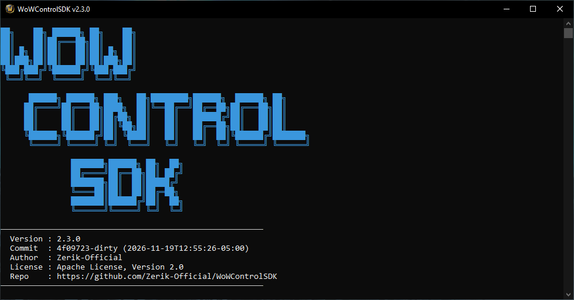
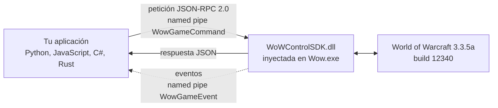

<h1 align="center">WoWControlSDK</h1>

<p align="center">
  
  
  
  
</p>

<p align="center">
  
  
  
  
</p>

<p align="center">
  
</p>

<p align="center">
  <strong>Español</strong> | <a href="./README.md">English</a>
</p>

> [!CAUTION]
> WoWControlSDK no es una herramienta de hacking, trampas o bots. Está pensado para integraciones legítimas como launchers, overlays de stream, Discord Rich Presence y automatización de interfaz. Muchos de sus métodos también pueden facilitar el botting, así que úsalo de forma responsable. El autor no se hace responsable de suspensiones o baneos causados por un mal uso.

WoWControlSDK es una DLL inyectable ligera y un SDK para **World of Warcraft 3.3.5a (build 12340)**. Expone los métodos internos del juego mediante **JSON-RPC 2.0** sobre named pipes de Windows, de modo que launchers, overlays, herramientas de automatización y otras aplicaciones externas pueden leer el estado del juego y controlar el cliente desde cualquier lenguaje.

La DLL se ejecuta dentro de `Wow.exe`. Un cliente se conecta a `\\.\pipe\WowGameCommand`, envía una petición JSON-RPC y recibe una respuesta JSON. Un segundo pipe, `\\.\pipe\WowGameEvent`, transmite eventos como cambios de pantalla, progreso de carga y eventos UI de WoW suscritos.

## Qué ofrece

| Área | Métodos y comportamiento |
| --- | --- |
| Lua | `lua.execute`, `lua.evaluate`, `lua.getGlobal`, `lua.setGlobal`, `lua.createNamespace` |
| Unidades | Salud, poder, posición, rotación, raza, clase, nivel, GUID, objetivo y flags de estado para `player`, `target`, `focus`, `mouseover`, `partyN`, `raidN` y GUIDs |
| Grupo y raid | Lista de miembros, resumen de combate y GUID del líder, reconstruidos solo cuando cambia la composición |
| Jugador y mundo | Estado cacheado del jugador, experiencia, AFK, DND, bajo el agua, mapa y zona |
| Control del cliente | Login, selección de reino, lista de personajes, entrar al mundo, cerrar sesión, salir y aceptación de EULA y TOS |
| Estado de pantalla | Pantalla glue actual, estado de login y diagnóstico de autenticación de bajo nivel |
| Eventos | Suscripción a eventos UI de WoW y streaming por el pipe de eventos, con búfer circular de historial |
| Ventana | Mostrar, ocultar, minimizar, maximizar, enfocar, mover, redimensionar, opacidad, siempre visible, título, icono y parpadeo de la barra de tareas |
| Diagnóstico | Consola superpuesta en el juego, logs capturados e información de la DLL |

## Arquitectura



Todo el acceso a la memoria del juego está aislado en la capa `core/`. La capa `rpc/` solo parsea y serializa JSON; nunca lee memoria ni usa direcciones crudas. Consulta la [documentación de arquitectura](docs/es/architecture.md) para el modelo completo de capas.

## Requisitos

| Herramienta | Versión | Uso |
| --- | --- | --- |
| Windows | 10 u 11, x64 | SDK e inyector |
| Visual Studio | 2022 con la carga de trabajo Desarrollo de escritorio con C++ | Compilador C++17 |
| CMake | 3.20 o posterior | Sistema de compilación |
| Git | 2.40 o posterior | Control de versiones |
| Python | 3.10 o posterior | Herramienta CLI y documentación |
| pywin32 | Última versión | Herramienta CLI |

Solo se soporta **WoW 3.3.5a (build 12340)**. Se recomienda un cliente limpio y sin modificaciones; los clientes ligeramente modificados también pueden funcionar.

## Compilación

```bash
git clone https://github.com/Zerik-Official/WoWControlSDK.git
cd WoWControlSDK

cmake -B build -A Win32
cmake --build build --config Release
```

La compilación genera dos archivos:

| Archivo | Propósito |
| --- | --- |
| `bin/release/WoWControlSDK.dll` | El SDK que se inyecta en el juego |
| `bin/release/WowInjector.exe` | El inyector congelar-sincronizar incluido |

## Inyección

```bash
WowInjector.exe --wow "C:\World of Warcraft\Wow.exe" --dll "bin\release\WoWControlSDK.dll"
```

El inyector inicia `Wow.exe` suspendido, carga la DLL y espera hasta 15 segundos a que exista `\\.\pipe\WowGameCommand` antes de reanudar el juego. Esto garantiza que los hooks y los servidores de pipe estén listos antes del primer frame. Se puede usar cualquier otro inyector de DLL, pero en ese caso el SDK se inicializa de forma asíncrona.

## Enviar una petición

El pipe de comandos atiende una petición por conexión: conectar, escribir el objeto JSON, leer la respuesta y cerrar el handle. El siguiente ejemplo de Python requiere `pip install pywin32`:

```python
import json

import win32file


def rpc(method, params=None, request_id=1):
    pipe = win32file.CreateFile(
        r"\\.\pipe\WowGameCommand",
        win32file.GENERIC_READ | win32file.GENERIC_WRITE,
        0,
        None,
        win32file.OPEN_EXISTING,
        0,
        None,
    )
    try:
        request = {
            "jsonrpc": "2.0",
            "id": request_id,
            "method": method,
            "params": params or {},
        }
        win32file.WriteFile(pipe, json.dumps(request).encode("utf-8"))
        _, data = win32file.ReadFile(pipe, 65536)
        return json.loads(data.decode("utf-8").rstrip("\x00"))
    finally:
        win32file.CloseHandle(pipe)


print(rpc("unit.get", {"token": "player"}))
```

Una petición y su respuesta tienen este aspecto:

```json
{"jsonrpc": "2.0", "id": 1, "method": "unit.get", "params": {"token": "player"}}
```

```json
{"jsonrpc": "2.0", "id": 1, "result": {"exists": true, "health": 25000, "maxHealth": 25000, "name": "PlayerName", "position": {"x": 1234.5, "y": 2345.6, "z": 300.1}, "dead": false}}
```

## Métodos habituales

| Método | Descripción |
| --- | --- |
| `lua.execute` / `lua.evaluate` | Ejecuta Lua con o sin valor de retorno tipado |
| `unit.get` / `unit.state` / `unit.position` | Instantánea completa, flags de estado o posición en el mundo |
| `unit.mapPosition` | Posición normalizada en el mapa, solo para miembros de grupo o raid |
| `group.get` / `group.combatSummary` | Lista del grupo o raid y resumen de combate |
| `player.getState` / `world.getState` | Estado cacheado del jugador y del mundo |
| `client.login` / `client.enterWorld` | Autenticación, selección de reino y entrada al mundo |
| `client.getScreen` / `client.getCharacters` | Detección de pantalla y lista de personajes |
| `events.subscribe` / `events.getHistory` | Suscripción a eventos de WoW y lectura del historial |
| `dll.getInfo` / `dll.getLogs` | Diagnóstico de la DLL y logs capturados |
| `window.getInfo` / `window.setBounds` | Inspección y control del diseño de la ventana |

La referencia completa, con parámetros, campos de respuesta y ejemplos de cada método, está en la [documentación de métodos](docs/es/methods/index.md).

## Documentación

La documentación se publica en <https://zerik-official.github.io/WoWControlSDK/docs/> y se compila con MkDocs Material en inglés y español. El código fuente está en [`docs/`](docs/README.md).

Para servirla en local:

```bash
pip install -r requirements-docs.txt
mkdocs serve
```

El proyecto también está indexado en [DeepWiki](https://deepwiki.com/Zerik-Official/WoWControlSDK), que se actualiza cada 7 días.

## Comentarios

¿Encontraste un error o tienes una sugerencia? Abre un [issue](https://github.com/Zerik-Official/WoWControlSDK/issues) en GitHub o escribe por [Discord](https://discord.com/users/738137581295763576).

## Licencia

[Apache License 2.0](LICENSE)
