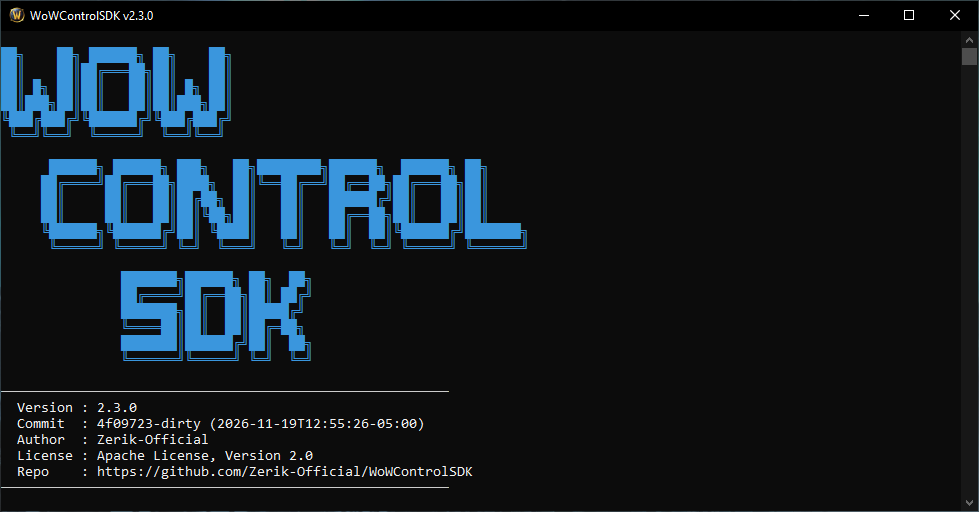
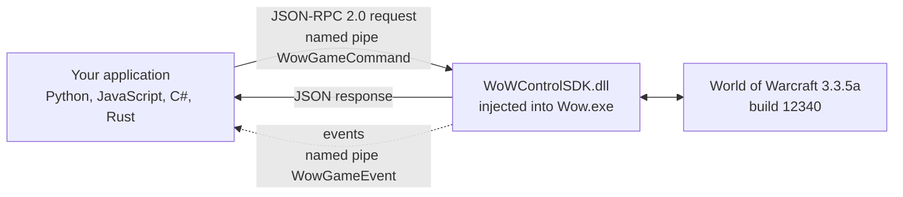

<h1 align="center">WoWControlSDK</h1>

<p align="center">
  
  
  
  
</p>

<p align="center">
  
  
  
</p>

<p align="center">
  <a href="https://deepwiki.com/Zerik-Official/WoWControlSDK"></a>
</p>

<p align="center">
  
</p>

<p align="center">
  <a href="./README.es.md">Español</a> | <strong>English</strong>
</p>

> [!CAUTION]
> WoWControlSDK is not a hacking, cheating or botting tool. It is intended for legitimate integrations such as launchers, stream overlays, Discord Rich Presence and UI automation. Many of its methods can also support botting, so use it responsibly. The author is not responsible for account suspensions or bans caused by misuse.

WoWControlSDK is a lightweight injectable DLL and SDK for **World of Warcraft 3.3.5a (build 12340)**. It exposes the internal methods of the game through **JSON-RPC 2.0** over Windows named pipes, so launchers, overlays, automation tools and other external applications can read game state and control the client from any language.

The DLL runs inside `Wow.exe`. A client connects to `\\.\pipe\WowGameCommand`, sends one JSON-RPC request and receives one JSON response. A second pipe, `\\.\pipe\WowGameEvent`, streams events such as screen changes, loading progress and subscribed WoW UI events.

## What it provides

| Area | Methods and behavior |
| --- | --- |
| Lua | Run code, call functions by path, read and write tables, refs, hooks and batches, with taint by default and blocked actions reported |
| Addon bridge | Addons that opt in send events to your application with `SDK.Emit`; code from `/run`, the server or other players cannot reach it. Scripts sent by the application run as virtual addons that survive `/reload` and can be unloaded with everything they created |
| Units | Health, power, position, rotation, race, class, level, GUID, target and state flags for `player`, `target`, `focus`, `mouseover`, `partyN`, `raidN` and GUIDs |
| Group and raid | Full roster including members out of range, roles, loot method, difficulties, combat summary, and native accept or decline of group invitations |
| Player and world | Cached player state, experience, AFK, DND, underwater state, map, zone, instance type and difficulty |
| Social | Friend list with online and offline events, whispers, chat on every channel with whisper replies, and native accept or decline of summons |
| Dungeon Finder | Proposal details, members, encounters, and native enter or leave queue |
| Trade and duels | Trade requests, both sides of the trade window, accept and cancel; duel requests, accept and decline |
| Battlegrounds and arenas | Queue status, wait times and native enter or leave queue |
| Client control | Login, realm selection, character list, enter world, logout, quit, EULA and TOS acceptance |
| Screen state | Current glue screen, login state and low-level authentication diagnostics |
| Events | WoW UI event subscriptions plus SDK events for loading screens, social activity, trades, duels and queues, all streamed over the event pipe with a circular history buffer |
| Security | Pipes restricted to local connections from the Windows user that runs the game, and a per-session token on every request |
| Window | Show, hide, minimize, maximize, focus, move, resize, opacity, top-most, title, icon, taskbar flash and hidden starts for headless launches |
| Diagnostics | Latency, FPS, addon memory, crash reports with the game's error log, Lua errors, in-game console overlay, captured game logs and DLL information |

## Architecture



All game memory access is isolated in the `core/` layer. The `rpc/` layer parses and serializes JSON only; it never reads memory or uses raw addresses. See the [architecture documentation](https://zerik-official.github.io/WoWControlSDK/docs/architecture/) for the full layer model.

## Requirements

| Tool | Version | Used for |
| --- | --- | --- |
| Windows | 10 or 11, x64 | SDK and injector |
| Visual Studio | 2022 with the Desktop development with C++ workload | C++17 compiler |
| CMake | 3.20 or later | Build system |
| Git | 2.40 or later | Source control |
| Python | 3.10 or later | Desktop client and documentation |
| customtkinter and pywin32 | See `requirements.txt` | Desktop client |

Only **WoW 3.3.5a (build 12340)** is supported. A clean, unmodified client is recommended; lightly modified clients may also work.

## Build

```bash
git clone https://github.com/Zerik-Official/WoWControlSDK.git
cd WoWControlSDK

cmake -B build -A Win32
cmake --build build --config Release
```

The build writes two files:

| File | Purpose |
| --- | --- |
| `bin/release/WoWControlSDK.dll` | The SDK injected into the game |
| `bin/release/WowInjector.exe` | The included freeze-sync injector |

## Inject

Since 2.0 both pipes require a session token. Generate a new random token of 32 to 128 hexadecimal characters for each game session and pass it to the injector through standard input, so it never appears on a command line:

```bash
echo %WOW_SDK_TOKEN% | WowInjector.exe --wow "C:\World of Warcraft\Wow.exe" --dll "bin\release\WoWControlSDK.dll" --token-stdin
```

The injector starts `Wow.exe` suspended, loads the DLL, registers the token and waits up to 15 seconds for `\\.\pipe\WowGameCommand` before resuming the game. This guarantees that hooks and pipe servers are ready before the first frame and that no other process can claim the session first. Any other DLL injector can be used, but the game will then initialize the SDK asynchronously and the first client that calls `auth.init` configures authentication.

> [!IMPORTANT]
> The injector needs exactly one of `--token-stdin` or `--no-auth`. Use `--no-auth` only for local development tools: it lets any process of your Windows user control the game. See [authentication](https://zerik-official.github.io/WoWControlSDK/docs/protocol/#authentication) for the full flow.

## Send a request

The command pipe handles one request per connection: connect, write the JSON object, read the response and close the handle. Every request carries the session token in a top-level `auth` field. The following Python example requires `pip install pywin32` and reads the token from the `WOW_SDK_TOKEN` environment variable:

```python
import json
import os

import win32file

TOKEN = os.environ["WOW_SDK_TOKEN"]


def rpc(method, params=None, request_id=1):
    pipe = win32file.CreateFile(
        r"\\.\pipe\WowGameCommand",
        win32file.GENERIC_READ | win32file.GENERIC_WRITE,
        0,
        None,
        win32file.OPEN_EXISTING,
        0,
        None,
    )
    try:
        request = {
            "jsonrpc": "2.0",
            "id": request_id,
            "method": method,
            "params": params or {},
            "auth": TOKEN,
        }
        win32file.WriteFile(pipe, json.dumps(request).encode("utf-8"))
        _, data = win32file.ReadFile(pipe, 65536)
        return json.loads(data.decode("utf-8").rstrip("\x00"))
    finally:
        win32file.CloseHandle(pipe)


print(rpc("unit.get", {"token": "player"}))
```

A request and its response look like this:

```json
{"jsonrpc": "2.0", "id": 1, "method": "unit.get", "params": {"token": "player"}, "auth": "<session token>"}
```

```json
{"jsonrpc": "2.0", "id": 1, "result": {"exists": true, "health": 25000, "maxHealth": 25000, "name": "PlayerName", "position": {"x": 1234.5, "y": 2345.6, "z": 300.1}, "dead": false}}
```

A missing or wrong token returns the JSON-RPC error `-32001 Unauthorized`. The `token` inside `params` is the unit token of `unit.get` and is unrelated to the session token.

To receive events, connect to `\\.\pipe\WowGameEvent` and first send `{"auth":"<session token>"}` followed by a newline; the SDK answers with an `auth.ok` event and starts streaming. The [events documentation](https://zerik-official.github.io/WoWControlSDK/docs/methods/events/#live-event-streaming) has a complete example.

## Common methods

| Method | Description |
| --- | --- |
| `lua.execute` / `lua.evaluate` | Run Lua with or without its return values |
| `lua.call` / `lua.getGlobal` | Call a function or read a value by path, with tables converted to JSON |
| `unit.get` / `unit.state` / `unit.position` | Full unit snapshot, state flags or world position |
| `unit.mapPosition` | Normalized map position for party and raid members only |
| `group.get` / `group.combatSummary` | Group or raid roster and combat summary |
| `group.acceptInvite` / `group.declineInvite` | Answer a group invitation |
| `player.getState` / `world.getState` | Cached player and world state, including instance and difficulty |
| `friends.list` | Friend list with level, class, zone and status |
| `summon.accept` / `lfg.acceptProposal` | Accept a summon or enter a Dungeon Finder group |
| `trade.get` / `trade.accept` | Read and accept a trade |
| `duel.accept` / `battlefield.acceptPort` | Accept a duel or enter a battleground or arena |
| `client.login` / `client.enterWorld` | Authenticate, select a realm and enter the world |
| `client.getScreen` / `client.getCharacters` | Screen detection and character list |
| `events.subscribe` / `events.getHistory` | Subscribe to WoW events and read buffered events |
| `dll.getInfo` / `dll.getLogs` | DLL diagnostics and captured game logs |
| `window.getInfo` / `window.setBounds` | Window inspection and layout control |

The full reference, with parameters, response fields and examples for every method, is in the [methods documentation](https://zerik-official.github.io/WoWControlSDK/docs/methods/).

## Desktop client

WoWControl Client calls every method from generated forms, launches the game with a session token and shows live events. Each release includes `WoWControlClient-<version>.zip`, ready to run with the SDK binaries inside. To run it from source:

```bash
pip install -r requirements.txt
cd tools
python -m wowsdk_client
```

See the [desktop client documentation](https://zerik-official.github.io/WoWControlSDK/docs/operations/cli/) for the window, the settings and how to build it.

## Documentation

The documentation is published at <https://zerik-official.github.io/WoWControlSDK/docs/> and built with MkDocs Material in English and Spanish. The source lives in [`docs/`](docs/README.md).

To serve it locally:

```bash
pip install -r requirements-docs.txt
mkdocs serve
```

The project is also indexed on [DeepWiki](https://deepwiki.com/Zerik-Official/WoWControlSDK), which updates every 7 days.

## Feedback

Found a bug or have a suggestion? Open an [issue](https://github.com/Zerik-Official/WoWControlSDK/issues) on GitHub or reach out on [Discord](https://discord.com/users/738137581295763576).

## License

[Apache License 2.0](LICENSE)
