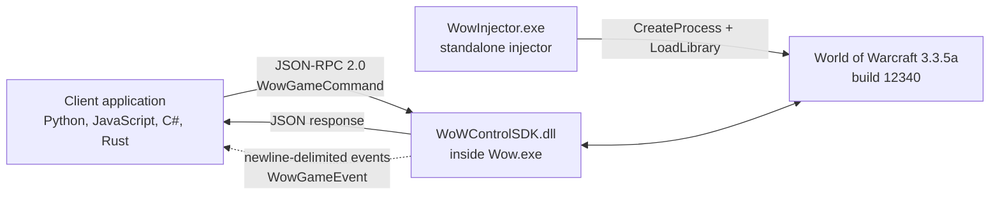
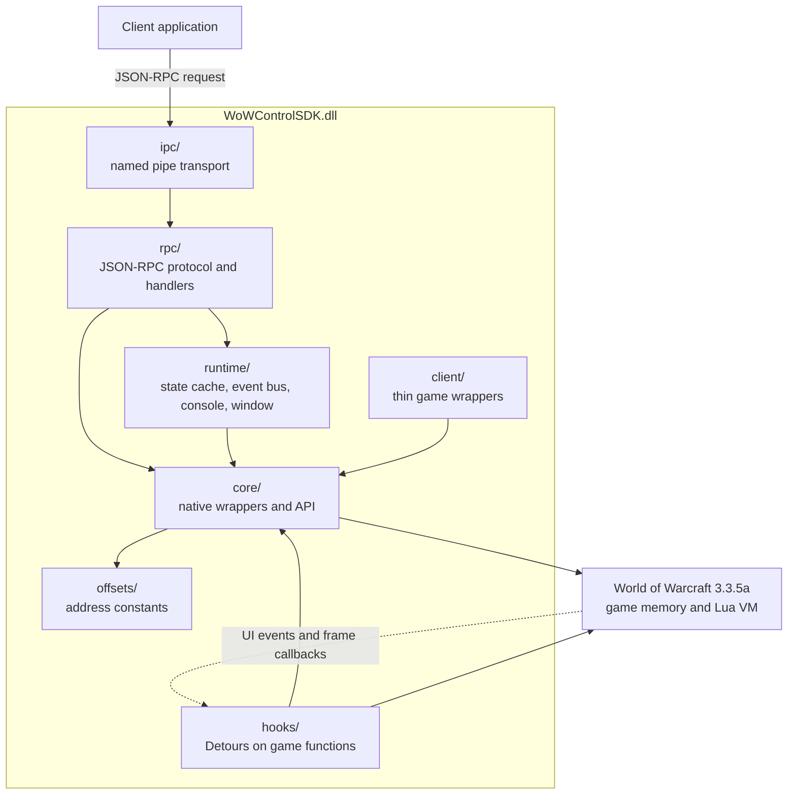
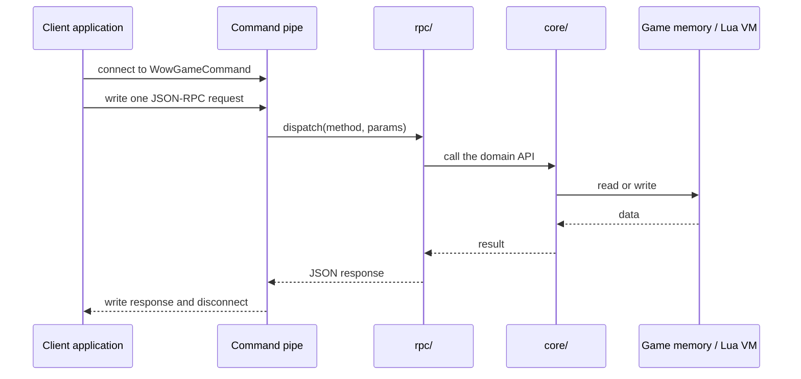
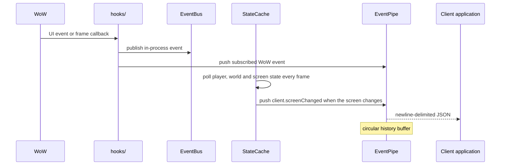

# Architecture

WoWControlSDK follows a strict layered architecture. Each layer has a defined responsibility and must not cross into the domain of another layer. All game memory access is concentrated in `core/`, which keeps the protocol, the runtime services and the hooks independent from raw addresses.

## Components

| Component | Responsibility | Runs in |
| --- | --- | --- |
| `WowInjector.exe` | Launches `Wow.exe` suspended, injects the DLL and waits for the command pipe | Standalone process |
| `WoWControlSDK.dll` | Hooks, memory access, Lua bridge, RPC server and event pipe | `Wow.exe` process |
| Client application | Sends JSON-RPC requests, consumes responses and events | Any process or language |

## Layered design

### Layer responsibilities

| Layer | Role | Game memory access |
| --- | --- | --- |
| `injector/` | Standalone executable that launches WoW and injects the DLL | None |
| `ipc/` | Named pipe transport and raw JSON read/write | None |
| `rpc/` | JSON-RPC 2.0 parsing, dispatch, handlers and serialization | None |
| `runtime/` | State cache, event bus, event pipe, console, log capture, realm list and window service | None directly; reads through `core/` |
| `hooks/` | Detour hooks on game functions and event signal capture | Through `core/` and `offsets/` only |
| `core/` | Native wrappers, API layer, memory reads and writes, resolvers | Yes, the only layer allowed to do so |
| `client/` | Thin wrappers around `core/` and game Lua for login, console and errors | Minimal addresses |
| `offsets/` | Every hardcoded address and structure offset as `constexpr uintptr_t` | Constants only |

Routers and handlers never read memory directly. They call `core/` APIs or read the `runtime/` cache, which keeps the protocol layer testable and the memory layout replaceable.

## Request flow

1. The client connects to `\\.\pipe\WowGameCommand`.
2. `ipc/CommandPipe` reads one message, up to 4096 bytes.
3. `rpc/Dispatcher` validates the envelope and routes the request to the registered handler.
4. The handler calls a `core/` API, reads the `runtime/` cache or posts work to the game thread.
5. `Dispatcher` wraps the handler result in a JSON-RPC response.
6. `ipc/CommandPipe` writes the response, flushes it and disconnects the client.

The command pipe serves **one request per connection**. Clients must open a new pipe handle for every request. The event pipe is the long-lived connection.

## Event flow

1. WoW fires a UI event such as `PLAYER_LOGIN` or `PLAYER_ENTERING_WORLD`.
2. `hooks/EventHooks` captures it through a detour.
3. If the event is subscribed with `events.subscribe`, it is pushed to `\\.\pipe\WowGameEvent`.
4. `StateCache` polls player, world and screen state on every frame.
5. When the glue screen changes, `StateCache` pushes `client.screenChanged`.
6. Loading hooks push `loading.startup`, `loading.progress`, `loading.finished` and `loading.cancelled`.

Events are also stored in a circular buffer that `events.getHistory` can read. The event pipe accepts one external client at a time and writes one JSON object per line.

## Threading model

| Thread | Role |
| --- | --- |
| Game thread (main/frame) | Runs the WoW frame loop. Hook callbacks and `StateCache::update()` execute here. Game memory reads happen on this thread. |
| RPC pipe thread | Accepts command pipe connections, reads one request and dispatches it. Blocks on `ReadFile`. |
| Event pipe thread | Accepts one event pipe client and blocks on `WriteFile` while pushing events. |
| DLL initialization thread | Started from `DllMain`, initializes logging, hooks, the Lua engine, the runtime and the pipes. |
| RPC handler execution | Some handlers post work to the game thread through `Hooks::Frame::Post`; others block the RPC thread while polling. |

!!! note
    Lua operations (`lua.evaluate` and `lua.execute`) use `lua_pcall` with `errfunc=0` and are safe to call from the RPC thread. State-changing operations such as login, logout and enter world are posted to the game thread to avoid races.

## Offsets isolation

Every hardcoded game address, function pointer and structure offset is defined as `constexpr uintptr_t` in `offsets/Offsets*.h`. No raw `0x...` literal appears outside that folder. Source files reference the constants as `Offsets::Namespace::CONSTANT`.

| File | Contents |
| --- | --- |
| `OffsetsClient.h` | Client state, net client and the in-world flag |
| `OffsetsConsole.h` | CVar functions |
| `OffsetsFrame.h` | Render frame and D3D |
| `OffsetsGroup.h` | Group and raid structures |
| `OffsetsLoading.h` | Loading screen state, progress and the `Map` / `LoadingScreens` tables |
| `OffsetsLogin.h` | Authentication, logout and character list |
| `OffsetsLua.h` | Lua state and signal event handler |
| `OffsetsMap.h` | Map position conversion |
| `OffsetsObjectMgr.h` | Object manager |
| `OffsetsPlayer.h` | Player-specific offsets |
| `OffsetsUnit.h` | Unit structure, movement and auras |

## Event system

The event system has two independent layers.

**EventBus** (`runtime/events/EventBus.h`) is the in-process publish/subscribe bus. `StateCache` uses it to emit events such as `player.healthChanged` and `world.zoneChanged`. No internal component subscribes to those events today; the bus is available for future in-process use.

**EventPipe** (`runtime/events/EventPipe.h`) is the external stream at `\\.\pipe\WowGameEvent`. `StateCache` writes `client.screenChanged`, and `LoadingHooks` writes the loading events. Subscribed WoW UI events are written by `EventHooks`. `EventHooks` also hands social, trade, duel, queue and whisper events to `runtime/events/GameEventBridge`, which reads the related data through `core/api/` and writes the `friends.*`, `group.invite*`, `summon.*`, `lfg.*`, `trade.*`, `duel.*`, `battlefield.*` and `chat.whisperReceived` events. `hooks/SocialHooks` detours the native functions behind the invitation, summon, trade and duel buttons so answers given in the game are reported too. The pipe runs in byte mode and separates messages with a newline.

Events pushed to the event pipe fall into two groups:

| Group | Events |
| --- | --- |
| SDK events, pushed automatically | `client.screenChanged`, `loading.startup`, `loading.progress`, `loading.finished`, `loading.cancelled` |
| WoW UI events, pushed after `events.subscribe` | `PLAYER_LOGIN`, `PLAYER_ENTERING_WORLD`, `UNIT_HEALTH`, `ZONE_CHANGED`, and any other event fired by `FrameScript_SignalEvent` |

The event history is a circular buffer with a default of 256 entries. `events.getHistory`, `events.clearHistory` and `events.setMaxBuffer` manage it, and the same entries are written to the pipe when a client is connected.

## State cache

`runtime/state/StateCache` refreshes player, world and screen state once per frame. The `player.*` and `world.*` domains read that cache instead of posting a request to the game thread, so they return quickly and cost the same regardless of game load. Group data is read from the client's group tables on the game thread on every call, so it always reflects the latest values sent by the server.
