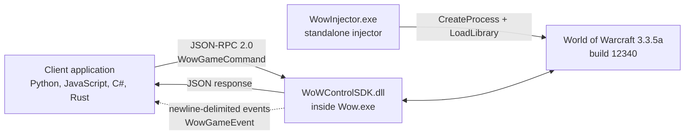
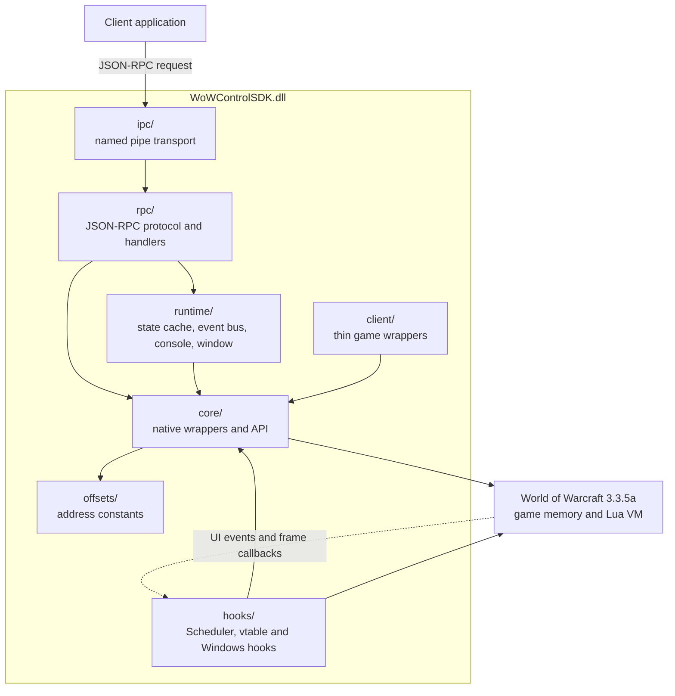
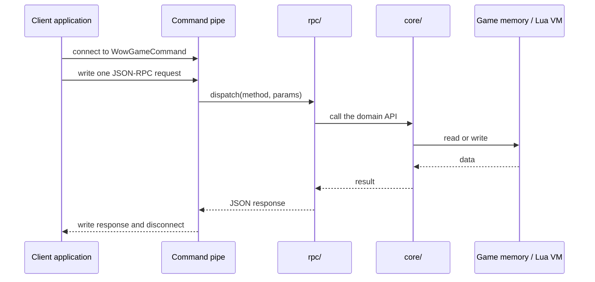
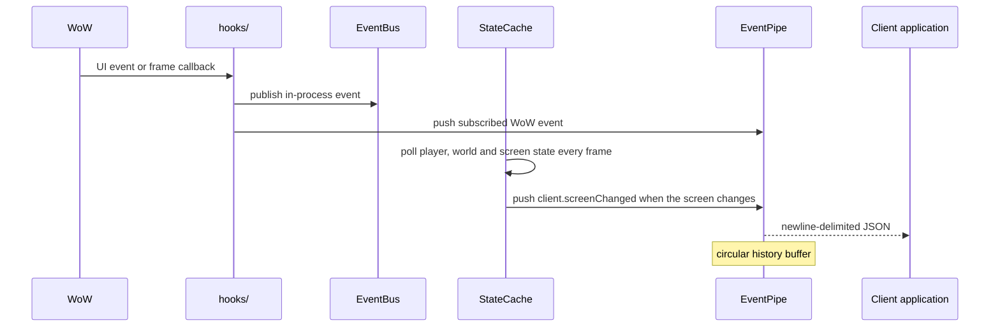

# Architecture

WoWControlSDK follows a layered architecture. Each layer has a defined responsibility. Game memory access is concentrated in `core/`, although the login helpers in `client/` also read and write a few game addresses directly. The protocol, runtime services and hooks stay independent from the addresses themselves.

## Components

| Component | Responsibility | Runs in |
| --- | --- | --- |
| `WowInjector.exe` | Launches `Wow.exe` suspended, injects the DLL and waits for the command pipe | Standalone process |
| `WoWControlSDK.dll` | Hooks, memory access, Lua bridge, RPC server and event pipe | `Wow.exe` process |
| Client application | Sends JSON-RPC requests, consumes responses and events | Any process or language |

## Layered design

### Layer responsibilities

Every layer lives under `src/`. The repository root keeps the build files, `deps/`, `docs/` and `tools/`.

| Layer | Role | Game memory access |
| --- | --- | --- |
| `injector/` | Standalone executable that launches WoW and injects the DLL | None |
| `ipc/` | Named pipe transport and raw JSON read/write | None |
| `rpc/` | JSON-RPC 2.0 parsing, dispatch, handlers and serialization | None |
| `runtime/` | State cache, event bus, event pipe, console, log capture, realm list and window service | None directly; reads through `core/` |
| `hooks/` | Game scheduler callbacks, vtable hooks, Windows event and CBT hooks for the hidden start and debug register breakpoints. Game code is never patched; the only import table slot written is the one that starts the scheduler, restored after its first call | Through `core/` and `offsets/` only |
| `core/` | Native wrappers, API layer, memory reads and writes, resolvers | Yes. Most memory access lives here |
| `client/` | Thin wrappers around `core/` and game Lua for login, console and errors | A few direct reads and writes for login and console (`LoginAPI.cpp`, `ConsoleAPI.cpp`) |
| `offsets/` | Base addresses and most structure offsets as `constexpr uintptr_t` | Constants only |

RPC routers and handlers never read memory directly. They call `core/` APIs or read the `runtime/` cache, which keeps the protocol layer testable and most of the memory layout replaceable.

## Request flow

1. The client connects to `\\.\pipe\WowGameCommand`.
2. `ipc/CommandPipe` reads one message, up to 1 MiB.
3. `rpc/Dispatcher` validates the envelope and routes the request to the registered handler.
4. The handler calls a `core/` API, reads the `runtime/` cache or posts work to the game thread.
5. `Dispatcher` wraps the handler result in a JSON-RPC response.
6. `ipc/CommandPipe` writes the response, flushes it and disconnects the client.

The command pipe serves **one request per connection**. Clients must open a new pipe handle for every request. The event pipe is the long-lived connection.

## Event flow

1. WoW fires a UI event such as `PLAYER_LOGIN` or `PLAYER_ENTERING_WORLD`.
2. The SDK Lua bridge frame receives it through the game's own event dispatch.
3. If the event is subscribed with `events.subscribe`, it is pushed to `\\.\pipe\WowGameEvent`.
4. `StateCache` polls player, world and screen state on every frame.
5. When the glue screen changes, `StateCache` pushes `client.screenChanged`.
6. Loading hooks push `loading.startup`, `loading.progress`, `loading.finished` and `loading.cancelled`.

Events are also stored in a circular buffer that `events.getHistory` can read. The event pipe accepts one external client at a time and writes one JSON object per line.

## Threading model

| Thread | Role |
| --- | --- |
| Game thread (main/frame) | Runs the WoW frame loop. The SDK runs on it through an idle handler registered in the game scheduler. Hook callbacks and `StateCache::update()` execute here. Game memory reads happen on this thread. |
| RPC pipe thread | Accepts command pipe connections, reads one request and dispatches it. Blocks on `ReadFile`. |
| Event pipe accept thread | Accepts one event pipe client, performs the authentication handshake and then waits for that client to disconnect. |
| Event pipe write thread | Pushes queued events to the connected client with `WriteFile`. |
| DLL initialization thread | Started from `DllMain`, initializes logging, hooks, the Lua engine, the runtime and the pipes. |
| RPC handler execution | Some handlers post work to the game thread through `Hooks::Frame::Execute`; others block the RPC thread while polling. |

!!! note
    Every `lua.*` method runs on the game thread: the RPC thread hands the call to the next frame and waits for its result. State-changing operations such as login, logout and enter world are posted to the game thread to avoid races.

## Offsets isolation

Base addresses and most structure offsets are defined as `constexpr uintptr_t` in `offsets/Offsets*.h`, and source files reference them as `Offsets::Namespace::CONSTANT`. A few structure-relative offsets and bit masks remain as local constants in the code that uses them (for example `core/api/SummonAPI.cpp`, `core/native/WorldInfo.cpp` and `client/login/LoginAPI.cpp`), so an offset change is not always limited to one file.

| File | Contents |
| --- | --- |
| `OffsetsClient.h` | Client state, net client and the in-world flag |
| `OffsetsConsole.h` | CVar functions and the console line list |
| `OffsetsFrame.h` | Game scheduler and graphics device vtables |
| `OffsetsGroup.h` | Group and raid structures |
| `OffsetsLoading.h` | Loading screen state, progress and the `Map` / `LoadingScreens` tables |
| `OffsetsLogin.h` | Authentication, logout and character list |
| `OffsetsLua.h` | Lua state and event table |
| `OffsetsMap.h` | Map position conversion |
| `OffsetsObjectMgr.h` | Object manager |
| `OffsetsPlayer.h` | Player-specific offsets |
| `OffsetsSocial.h` | Friends, summon, LFG, trade, duel, battlefield, chat and Battle.net |
| `OffsetsUnit.h` | Unit structure, movement and auras |

## Event system

The event system has two independent layers.

**EventBus** (`runtime/events/EventBus.h`) is the in-process publish/subscribe bus. `StateCache` uses it to emit events such as `player.healthChanged` and `world.zoneChanged`. No internal component subscribes to those events today; the bus is available for future in-process use.

**EventPipe** (`runtime/events/EventPipe.h`) is the external stream at `\\.\pipe\WowGameEvent`. `StateCache` writes `client.screenChanged`, `LoadingHooks` writes the loading events, `hooks/DisconnectHooks` writes `client.disconnected` and `runtime/diagnostics/CrashMonitor` writes `client.crashed`. Subscribed WoW UI events and the `lua.*` events are written by `runtime/events/LuaEventBridge`, which receives them from the Lua bridge frame. It also hands social, trade, duel, queue and whisper events to `runtime/events/GameEventBridge`, which reads the related data through `core/api/` and writes the `friends.*`, `group.invite*`, `summon.*`, `lfg.*`, `trade.*`, `duel.*`, `battlefield.*` and `chat.whisperReceived` events. The Lua bridge hooks the invitation, summon, trade and duel functions with `hooksecurefunc`, so answers given in the game are reported too. The pipe runs in byte mode and separates messages with a newline.

Events pushed to the event pipe fall into two groups:

| Group | Events |
| --- | --- |
| SDK events, pushed automatically | `client.screenChanged`, `client.disconnected`, `client.crashed`, `loading.startup`, `loading.progress`, `loading.finished`, `loading.cancelled`, `friends.*`, `group.inviteReceived`, `group.inviteClosed`, `summon.*`, `lfg.*`, `trade.*`, `duel.*`, `battlefield.statusChanged`, `battlefield.ready`, `chat.whisperReceived`, `lua.error`, `lua.script`, `lua.custom`, `lua.hooked`, `lua.dropped`, `lua.blocked` |
| WoW UI events, pushed after `events.subscribe` | `PLAYER_LOGIN`, `PLAYER_ENTERING_WORLD`, `UNIT_HEALTH`, `ZONE_CHANGED`, and any other event fired by `FrameScript_SignalEvent` |

See [SDK event payloads](methods/events.md#sdk-event-payloads) for every event, its arguments and the disconnection flow.

The event history is a circular buffer with a default of 256 entries. `events.getHistory`, `events.clearHistory` and `events.setMaxBuffer` manage it, and the same entries are written to the pipe when a client is connected.

## State cache

`runtime/state/StateCache` refreshes player, world and screen state once per frame. The `player.*` and `world.*` domains read that cache instead of posting a request to the game thread, so they return quickly and cost the same regardless of game load. Group data is read from the client's group tables on the game thread on every call, so it always reflects the latest values sent by the server.
