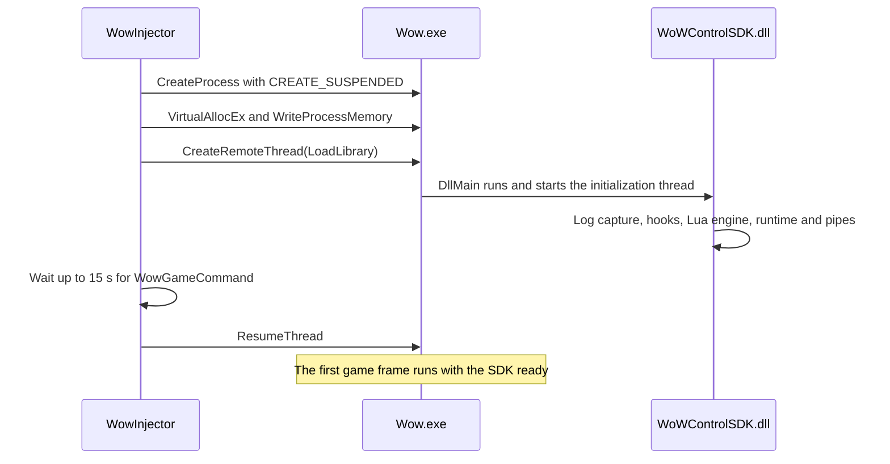

# Injection

WoWControlSDK ships with `WowInjector.exe`, a standalone injector that launches `Wow.exe`, injects the DLL and synchronizes startup so the SDK is fully initialized before the first game frame.

## Freeze-sync flow



1. **Launch suspended.** `Wow.exe` starts with `CREATE_SUSPENDED`, so no game code runs yet.
2. **Inject the DLL.** The injector allocates memory in the target process, writes the DLL path and calls `LoadLibrary` through `CreateRemoteThread`.
3. **Initialize the SDK.** `DllMain` starts a dedicated thread that initializes log capture, Detours hooks, the Lua engine, the runtime, the command pipe and the event pipe.
4. **Wait for the pipe.** The game remains frozen while the injector waits up to 15 seconds for `\\.\pipe\WowGameCommand` to accept a connection.
5. **Resume the game.** Once the pipe is ready, the injector resumes the main thread and the game runs normally.

This order removes the race between the first game frame and hook installation, and it prevents missed startup events.

## Usage

```bash
WowInjector.exe --wow "C:\World of Warcraft\Wow.exe" --dll "bin\release\WoWControlSDK.dll"
```

### Arguments

| Argument | Description |
| --- | --- |
| `--wow <path>` | Path to `Wow.exe`. Required. |
| `--dll <path>` | Path to `WoWControlSDK.dll`. Required. |
| `--pipe <name>` | Named pipe to wait for before unfreezing. Defaults to `WowGameCommand`. |
| `--no-pipe` | Unfreeze after `--wait` milliseconds instead of waiting for the pipe. |
| `--wait <ms>` | Milliseconds to wait when `--no-pipe` is active. Defaults to `500`. |
| `--kill` | Kill an existing `Wow.exe` process before launching. |
| `--wow-args <str>` | Extra arguments passed to `Wow.exe`. |
| `--pipe-cmd <json>` | Send a JSON-RPC command after the pipe is ready. Repeatable. |

### Example with options

The following example kills any running client, starts a new one and toggles the in-game console after initialization:

```cmd
WowInjector.exe ^
    --wow "C:\World of Warcraft\Wow.exe" ^
    --dll "C:\WoWControlSDK\bin\release\WoWControlSDK.dll" ^
    --kill ^
    --pipe-cmd "{\"jsonrpc\":\"2.0\",\"method\":\"dll.toggleConsole\",\"id\":1}"
```

!!! tip
    The freeze-sync flow is the recommended injection method. It guarantees that the DLL and its pipes are ready before any game frame runs, and that startup events can be captured.

## Alternative injection

Any DLL injector can be used, such as [Cheat Engine](https://www.cheatengine.org/). When the game is already running:

- The DLL initializes asynchronously.
- Hooks attach during the next frame.
- The command pipe becomes available shortly after injection.
- Events fired between game start and injection are missed.

The SDK itself does not depend on the included injector. The injector only automates the launch, injection and pipe synchronization.

## Startup commands

`--pipe-cmd` queues JSON-RPC commands that run immediately after the SDK initializes. Commands are sent in order, and each one waits for its response before the next is sent.

```cmd
WowInjector.exe --wow "..." --dll "..." ^
    --pipe-cmd "{\"jsonrpc\":\"2.0\",\"method\":\"dll.setLogConfig\",\"params\":{\"showInConsole\":true},\"id\":1}" ^
    --pipe-cmd "{\"jsonrpc\":\"2.0\",\"method\":\"dll.toggleConsole\",\"id\":2}"
```

Safe startup commands include `dll.toggleConsole`, `dll.setLogConfig` and `dll.getInfo`. Game-dependent commands such as `lua.*`, `client.login` and `unit.*` should wait until the player reaches the appropriate screen.

## Event pipe

In addition to the command pipe, the SDK opens `\\.\pipe\WowGameEvent` for streaming events. The SDK is the server and writes newline-delimited JSON; a client connects and reads the stream until it disconnects. Only one event client is accepted at a time.

```python
import json

import win32file

pipe = win32file.CreateFile(
    r"\\.\pipe\WowGameEvent",
    win32file.GENERIC_READ,
    0,
    None,
    win32file.OPEN_EXISTING,
    0,
    None,
)

try:
    buffer = ""
    while True:
        _, data = win32file.ReadFile(pipe, 65536)
        buffer += data.decode("utf-8", errors="replace")
        while "\n" in buffer:
            line, buffer = buffer.split("\n", 1)
            if line.strip():
                print(json.loads(line))
finally:
    win32file.CloseHandle(pipe)
```

See [events.*](methods/events.md) for the available events and the CLI listener.

## Troubleshooting

| Symptom | Cause and fix |
| --- | --- |
| The injector exits after 15 seconds | The pipe never appeared. Check that the DLL path is correct and that the DLL matches the client build. |
| The game stays suspended | The injector is still waiting for the pipe. Run with `--no-pipe --wait 1000` to skip the wait for diagnosis. |
| `LoadLibrary` fails | The DLL is missing a dependency, or the process architecture does not match. Build with the provided CMake configuration. |
| No events arrive | The event pipe accepts one client. Disconnect other listeners and subscribe to the events you need. |
| Events fired before injection are missing | Use the included injector with freeze-sync, or accept that early events are lost with a third-party injector. |
