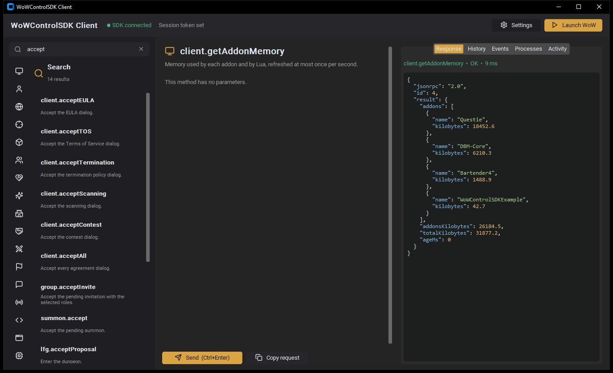
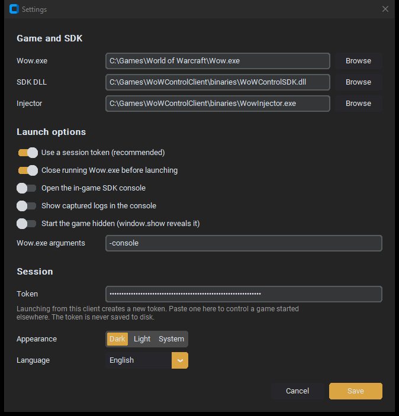
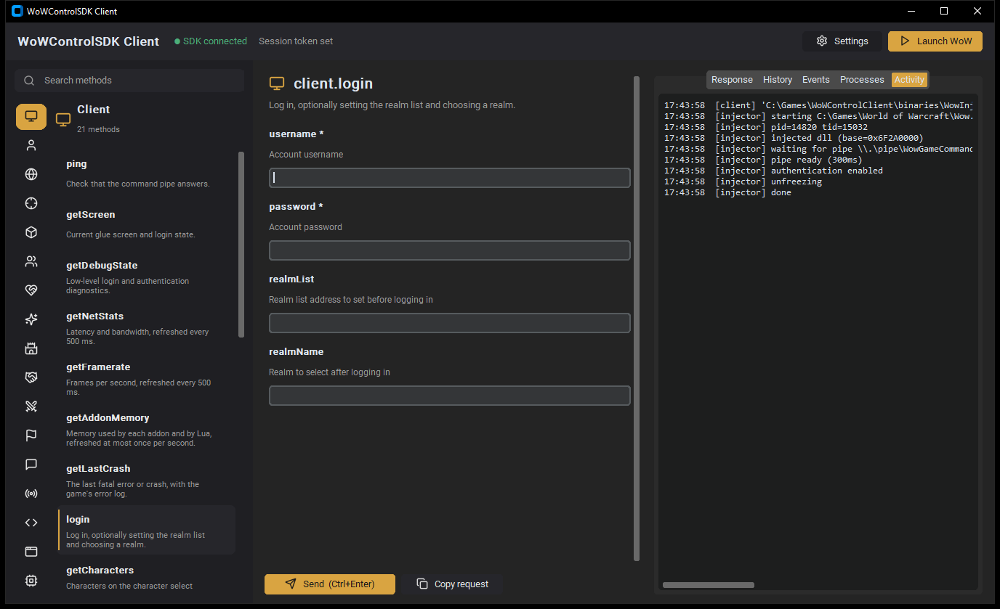
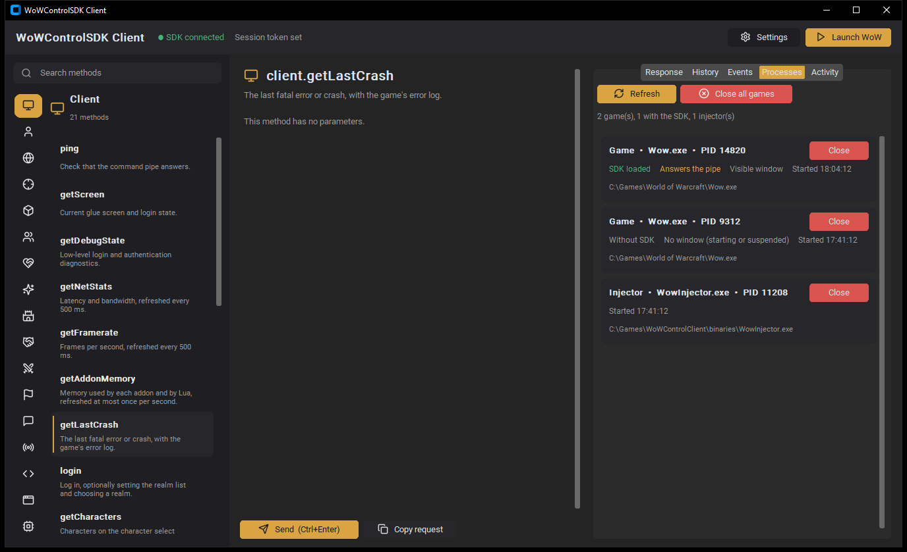

# Desktop client

WoWControl Client is a desktop application for calling every SDK method and watching its events. It starts the game with the injector and a session token, builds a form for each method, shows the JSON response, keeps a history of calls and lists the running games. It is useful for manual testing, for inspecting responses and as a reference for a custom integration.

The interface is available in English and Spanish.


## Download

Every release includes `WoWControlClient-<version>.zip` next to the SDK package. Extract it anywhere and run `WoWControlClient.exe`. The folder already contains `binaries/WoWControlSDK.dll` and `binaries/WowInjector.exe`, so only the path of `Wow.exe` has to be set.

The client is built as a folder (`WoWControlClient.exe` plus `_internal/`) instead of a single executable, so it starts quickly and is not unpacked to a temporary folder on every run. Keep the whole folder together.

## Run from source

| Tool | Version | Purpose |
| --- | --- | --- |
| Python | 3.10 or later | Runs the client |
| customtkinter | 6.0.0 | Interface |
| pywin32 | 312 | Named pipes and processes |
| Pillow | 12.2.0 | Icons |

```bash
pip install -r requirements.txt
cd tools
python -m wowsdk_client
```

From source the client uses `bin/release/WoWControlSDK.dll` and `bin/release/WowInjector.exe` of the repository when they exist.

## Build

```bash
pip install -r requirements-build.txt
pyinstaller --noconfirm --clean --windowed --onedir --name WoWControlClient --paths tools --collect-data customtkinter --collect-data wowsdk_client --distpath dist --workpath build/pyinstaller --specpath build/pyinstaller tools/run_client.py
```

The client is written to `dist/WoWControlClient/`. `--windowed` hides the console window, `--onedir` keeps the folder layout and `--collect-data wowsdk_client` includes the method catalog, the translations and the icons. The CI workflow runs the same command on every pull request and uploads the folder as an artifact.

## Window

| Area | Content |
| --- | --- |
| Header | SDK status (whether the command pipe exists), session token state, **Settings** and **Launch WoW** |
| Method browser | A rail with one icon per domain and the methods of the selected domain as cards with their description. The search box looks in every domain |
| Form | The selected method with one input per parameter: text, password, number, switch, list, Lua code or JSON. Required parameters are marked with `*` |
| Response | The JSON response with colors, the call status and the time it took |
| History | The last 100 calls; selecting one shows its request and response |
| Events | Live view of the event pipe with a name filter, pause and clear |
| Processes | Every `Wow.exe` and `WowInjector.exe` that is running, with the option to close them |
| Activity | Injector output, event pipe status and client messages |

Press **Send** or `Ctrl+Enter` to send the request. Calls run on a worker thread, so slow methods such as `client.login` or `client.enterWorld` do not freeze the window. **Copy request** copies the JSON request with the token replaced by a placeholder. `client.quit` asks for confirmation.

### Finding a method

Select a domain on the rail to list its methods, or type in the search box to look for a word in every method name and description. The search uses the language of the interface.



## Settings

| Setting | Description |
| --- | --- |
| Wow.exe | Path of the game executable |
| SDK DLL and Injector | Paths of `WoWControlSDK.dll` and `WowInjector.exe`. Empty uses the bundled or built ones |
| Use a session token | Launch with `--token-stdin` and a new token for each session (recommended). When off, the client launches with `--no-auth` |
| Close running Wow.exe before launching | Passes `--kill` to the injector |
| Open the in-game SDK console | Sends `dll.toggleConsole` once the SDK is ready |
| Show captured logs in the console | Sends `dll.setLogConfig` with `showInConsole`. Messages captured before the console opened, such as the archives loaded at startup, are shown too |
| Start the game hidden | Passes `--hidden` to the injector; send `window.show` to reveal the window |
| Wow.exe arguments | Passed with `--wow-args`; `-console` by default |
| Token | Token used for requests and the event pipe. Paste one to control a game started elsewhere |
| Appearance | Dark, light or system theme |
| Language | English, Spanish or the Windows language. The change applies after restarting the client |



Settings are stored in `%APPDATA%\WoWControlClient\settings.json`. The session token is kept in memory only and is never written to disk.

## Launching the game

**Launch WoW** generates a 64-character hexadecimal token, starts the injector without a console window and writes the token to its standard input, so the token never appears on a command line. The injector output, including the game process id, appears in **Activity**. Every request then carries the token in its `auth` field.



When **Close running Wow.exe before launching** is off and a game with the SDK or an injector is already running, the client warns that commands could reach the wrong game and offers to close them first.

### When the launch fails

If the injector ends with an error, the client shows its exit code, the most likely cause with what to do next, and the last error line. The injector also closes the game it started, so a failed launch never leaves a suspended `Wow.exe` behind.

| Injector message | Likely cause |
| --- | --- |
| `the SDK did not open its pipe` | The DLL was injected but failed while starting, for example because it does not match the client build |
| `the game closed while the SDK was starting` | The game crashed during startup; look for a new file in its `Errors` folder |
| `LoadLibraryA returned NULL` | Wrong DLL path, a 64-bit build or a missing Visual C++ x86 runtime |
| `CreateProcess` | Wrong `Wow.exe` path or blocked by security software |
| `auth.init rejected` | Another game with the SDK already had a session; close it in **Processes** |

## Processes

The **Processes** tab lists every running `Wow.exe` (or the executable set in the settings) and `WowInjector.exe`, and refreshes every 3 seconds while it is open.



| Label | Meaning |
| --- | --- |
| SDK loaded | `WoWControlSDK.dll` is loaded in the game |
| Answers the pipe | This game owns `\\.\pipe\WowGameCommand`, so the client's requests reach it |
| Visible window / Hidden window | The game has a window, shown or hidden |
| No window | The game is starting or was left suspended by an earlier failed launch |

**Close** ends one process after a confirmation, and **Close all games** ends every game and injector in the list. Closing a game loses anything the game had not saved.

## Live events

**Events → Connect** opens `\\.\pipe\WowGameEvent`, sends the authentication handshake and lists each event with its time, name and arguments. The filter matches event names, for example `trade.` or `UNIT_`.


The event pipe accepts one client at a time. If another program, such as a launcher, is connected, the client reports that the pipe is busy.

!!! tip
    SDK events such as `client.screenChanged`, `loading.*`, `group.inviteReceived`, `lua.custom` or `trade.requested` are always streamed. WoW UI events only appear after `events.subscribe`.

## Adding methods

The client builds every form from the JSON files in `tools/wowsdk_client/data/catalog/`. Each domain has its own file with its icon, its methods and their parameters, and every text is written in English and Spanish:

```json
{
  "name": "client.getNetStats",
  "description": {
    "en": "Latency and bandwidth, refreshed every 500 ms.",
    "es": "Latencia y ancho de banda, actualizados cada 500 ms."
  }
}
```

A parameter adds `name`, `type` (`string`, `text`, `secret`, `integer`, `boolean`, `string_list`, `choice` or `json`), `description` and, when needed, `required`, `default` and `choices`. `index.json` sets the order of the domains on the rail. No interface code is needed for a new method.

The interface texts live in `tools/wowsdk_client/data/locales/en.json` and `es.json`.

| Module | Responsibility |
| --- | --- |
| `catalog.py` | Loads the method catalog |
| `i18n.py` | Interface language and texts |
| `transport.py` | One JSON-RPC request per command pipe connection, with the `auth` field |
| `events.py` | Event pipe reader on a worker thread |
| `launcher.py` | Injector command line, token generation, output forwarding and failure hints |
| `processes.py` | Running games and injectors, the SDK state of each one and closing them |
| `settings.py` | Settings file and bundled binary lookup |
| `ui/` | Window, method browser, method form, JSON view, events and processes panels and settings dialog |

The icons come from the Lucide set of [react-icons](https://react-icons.github.io/react-icons/). They are stored as white PNG files in `tools/wowsdk_client/data/icons/` and the client tints them for each theme.
