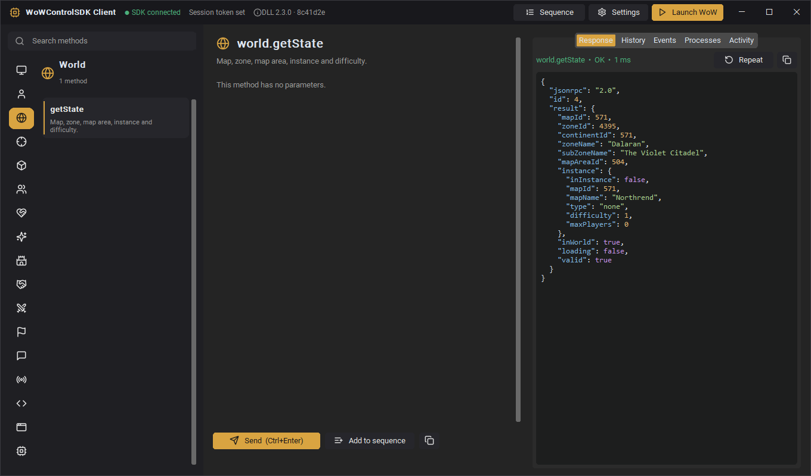

# Desktop client

WoWControl Client is a desktop application for calling every SDK method and watching its events. It starts the game with the injector and a session token, builds a form for each method, shows the JSON response and keeps a history of calls. It is useful for manual testing, for inspecting responses and as a reference for a custom integration.



## Download

Every release includes `WoWControlClient-<version>.zip` next to the SDK package. Extract it anywhere and run `WoWControlClient.exe`. The folder already contains `binaries/WoWControlSDK.dll` and `binaries/WowInjector.exe`, so only the path of `Wow.exe` has to be set.

The client is built as a folder (`WoWControlClient.exe` plus `_internal/`) instead of a single executable, so it starts quickly and is not unpacked to a temporary folder on every run. Keep the whole folder together.

## Run from source

| Tool | Version | Purpose |
| --- | --- | --- |
| Python | 3.10 or later | Runs the client |
| customtkinter | 6.0.0 | Interface |
| pywin32 | 312 | Named pipe access |

```bash
pip install -r requirements.txt
cd tools
python -m wowsdk_client
```

From source the client uses `bin/release/WoWControlSDK.dll` and `bin/release/WowInjector.exe` of the repository when they exist.

## Build

```bash
pip install -r requirements-build.txt
pyinstaller --noconfirm --clean --windowed --onedir --name WoWControlClient --paths tools --collect-data customtkinter --distpath dist --workpath build/pyinstaller --specpath build/pyinstaller tools/run_client.py
```

The client is written to `dist/WoWControlClient/`. `--windowed` hides the console window and `--onedir` keeps the folder layout. The CI workflow runs the same command on every pull request and uploads the folder as an artifact.

## Window

| Area | Content |
| --- | --- |
| Header | SDK status (whether the command pipe exists), session token state, **Settings** and **Launch WoW** |
| Sidebar | Every method grouped by domain, with a search box that matches names and descriptions |
| Form | The selected method with one input per parameter: text, password, number, switch, list, Lua code or JSON. Required parameters are marked with `*` |
| Response | The JSON response with colors, the call status and the time it took |
| History | The last 100 calls; selecting one shows its request and response |
| Events | Live view of the event pipe with a name filter, pause and clear |
| Activity | Injector output, event pipe status and client messages |


Press **Send** or `Ctrl+Enter` to send the request. Calls run on a worker thread, so slow methods such as `client.login` or `client.enterWorld` do not freeze the window. **Copy request** copies the JSON request with the token replaced by a placeholder. `client.quit` asks for confirmation.

## Settings

| Setting | Description |
| --- | --- |
| Wow.exe | Path of the game executable |
| SDK DLL and Injector | Paths of `WoWControlSDK.dll` and `WowInjector.exe`. Empty uses the bundled or built ones |
| Use a session token | Launch with `--token-stdin` and a new token for each session (recommended). When off, the client launches with `--no-auth` |
| Close running Wow.exe before launching | Passes `--kill` to the injector |
| Open the in-game SDK console | Sends `dll.toggleConsole` once the SDK is ready |
| Show captured logs in the console | Sends `dll.setLogConfig` with `showInConsole` |
| Wow.exe arguments | Passed with `--wow-args`; `-console` by default |
| Token | Token used for requests and the event pipe. Paste one to control a game started elsewhere |
| Appearance | Dark, light or system theme |


Settings are stored in `%APPDATA%\WoWControlClient\settings.json`. The session token is kept in memory only and is never written to disk.

## Launching the game

**Launch WoW** generates a 64-character hexadecimal token, starts the injector without a console window and writes the token to its standard input, so the token never appears on a command line. The injector output, including the game process id, appears in **Activity**. Every request then carries the token in its `auth` field.

## Live events

**Events → Connect** opens `\\.\pipe\WowGameEvent`, sends the authentication handshake and lists each event with its time, name and arguments. The filter matches event names, for example `trade.` or `UNIT_`.


The event pipe accepts one client at a time. If another program, such as a launcher, is connected, the client reports that the pipe is busy.

!!! tip
    SDK events such as `client.screenChanged`, `loading.*`, `group.inviteReceived` or `trade.requested` are always streamed. WoW UI events only appear after `events.subscribe`.

## Adding methods

The client builds every form from `tools/wowsdk_client/catalog.py`. To support a new SDK method, add a `Method` entry with its parameters to the matching `Domain`; no interface code is needed.

| Module | Responsibility |
| --- | --- |
| `catalog.py` | Methods, parameters and their input types |
| `transport.py` | One JSON-RPC request per command pipe connection, with the `auth` field |
| `events.py` | Event pipe reader on a worker thread |
| `launcher.py` | Injector command line, token generation and output forwarding |
| `settings.py` | Settings file and bundled binary lookup |
| `ui/` | Window, sidebar, method form, JSON view, events panel and settings dialog |
