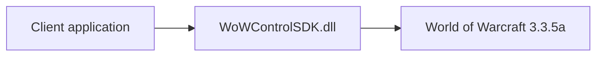

# Documentation site

The documentation is written in Markdown, built with MkDocs Material and published to GitHub Pages. English and Spanish are generated from the same navigation tree.

## Stack

| Component | Version | Role |
| --- | --- | --- |
| MkDocs | Installed with MkDocs Material | Static site generator |
| MkDocs Material | 9.5.39 | Theme, navigation and search |
| mkdocs-static-i18n | 1.3.1 | English and Spanish builds from folder structure |
| Mermaid | Loaded by Material | Flowcharts and sequence diagrams |
| GitHub Actions | `docs.yml` | Validation and deployment |

The versions are pinned in [`requirements-docs.txt`](https://github.com/Zerik-Official/WoWControlSDK/blob/main/requirements-docs.txt).

## Layout

```text
docs/
├── README.md           # Repository index, excluded from the site
├── en/                 # English site
│   ├── index.md
│   ├── getting-started.md
│   ├── architecture.md
│   ├── injection.md
│   ├── protocol.md
│   ├── glossary.md
│   ├── methods/
│   └── operations/
└── es/                 # Spanish site, same structure
    ├── index.md
    ├── getting-started.md
    ├── architecture.md
    ├── injection.md
    ├── protocol.md
    ├── glossary.md
    ├── methods/
    └── operations/
```

The i18n plugin uses `docs_structure: folder`: the first folder under `docs/` selects the language. Every English page must have a Spanish counterpart with the same relative path, and the other way around.

`docs/README.md` is excluded with `exclude_docs` because it is a repository index, not a site page.

## Serve locally

```bash
pip install -r requirements-docs.txt
mkdocs serve
```

| URL | Language |
| --- | --- |
| `http://127.0.0.1:8001/WoWControlSDK/docs/` | English |
| `http://127.0.0.1:8001/WoWControlSDK/docs/es/` | Español |

MkDocs watches the files and rebuilds the site when a page or `mkdocs.yml` changes.

## Build

```bash
mkdocs build --strict
```

`--strict` turns warnings into errors, so broken links or unreadable files fail the build. Pages that exist but are not listed in `nav` are only reported as an informational message, and a missing translation does not fail the build by itself. The CI uses the same command, so a local strict build is the closest check to the pipeline.

The output is written to `site/`, which is not tracked by Git.

## Navigation

The `nav` section of `mkdocs.yml` defines the order for both languages. Titles are written in English and translated with `nav_translations` for Spanish:

```yaml
nav:
  - Home: index.md
  - Getting started: getting-started.md
  - Architecture: architecture.md
  - Injection: injection.md
  - RPC protocol: protocol.md
  - Addon integration: addons.md
  - Methods:
      - methods/index.md
      - lua.*: methods/lua.md
      - unit.*: methods/unit.md
      - group.*: methods/group.md
      - player.*: methods/player.md
      - world.*: methods/world.md
      - friends.*: methods/friends.md
      - summon.*: methods/summon.md
      - lfg.*: methods/lfg.md
      - trade.*: methods/trade.md
      - duel.*: methods/duel.md
      - battlefield.*: methods/battlefield.md
      - chat.*: methods/chat.md
      - object.*: methods/object.md
      - client.*: methods/client.md
      - events.*: methods/events.md
      - dll.*: methods/dll.md
      - window.*: methods/window.md
  - Operations:
      - Building: operations/building.md
      - Desktop client: operations/cli.md
      - Releases: operations/releases.md
      - Documentation site: operations/documentation.md
  - Glossary: glossary.md
```

After adding a page, register it in `nav` and add the Spanish title to `nav_translations` if needed.

## Writing conventions

- Use sentence case for headings: `## Getting started`, not `## Getting Started`.
- Keep both languages structurally identical. A table, section or example in one language should exist in the other.
- Write in a guide voice: describe what a component does and how to use it. Avoid first-person narratives and project history.
- Use tables for parameters, response fields, tools and decisions.
- Use `!!! note`, `!!! tip` and `!!! warning` for callouts. The `admonition` extension renders them in the site.
- Use relative links inside the same language folder, for example `[Methods](methods/index.md)` or `[Building](../operations/building.md)`. The i18n plugin keeps them inside the current language.
- Use Mermaid for flows and relationships. Do not draw diagrams with box-drawing characters.

### Mermaid example

````markdown

````

Mermaid requires the `pymdownx.superfences` custom fence configured in `mkdocs.yml`. The `flowchart` and `sequenceDiagram` grammars cover every diagram in this documentation.

## Continuous integration

The `CI` workflow runs `mkdocs build --strict` on every pull request and push to `dev` and `main`.

The `docs` workflow runs on every push to `main`. It installs the dependencies, runs `mkdocs build --strict`, nests the site under `pages-root/docs/`, writes a root `index.html` that redirects to `docs/`, uploads the Pages artifact and lets the `deploy` job publish it. The deploy job also waits for the `rebuild` job, which compiles the DLL and the injector with the Win32 toolchain.

## GitHub Pages

The site is published at <https://zerik-official.github.io/WoWControlSDK/docs/>. The repository must use GitHub Actions as the Pages source:

1. Open **Settings → Pages**.
2. Set **Source** to **GitHub Actions**.
3. Push to `main` or run the `docs` workflow manually from the **Actions** tab.

The root of the Pages site redirects to `docs/`, so both URLs work:

| URL | Content |
| --- | --- |
| `https://zerik-official.github.io/WoWControlSDK/` | Redirect to the documentation |
| `https://zerik-official.github.io/WoWControlSDK/docs/` | English documentation |
| `https://zerik-official.github.io/WoWControlSDK/docs/es/` | Spanish documentation |

## Adding a page

1. Create the English page under `docs/en/` and the Spanish page at the same relative path under `docs/es/`.
2. Add the page to `nav` in `mkdocs.yml`.
3. Add the Spanish title to `nav_translations` if the navigation label is translated.
4. Link the page from the relevant index or overview.
5. Run `mkdocs build --strict` and fix every warning.
6. Review both language versions side by side.
