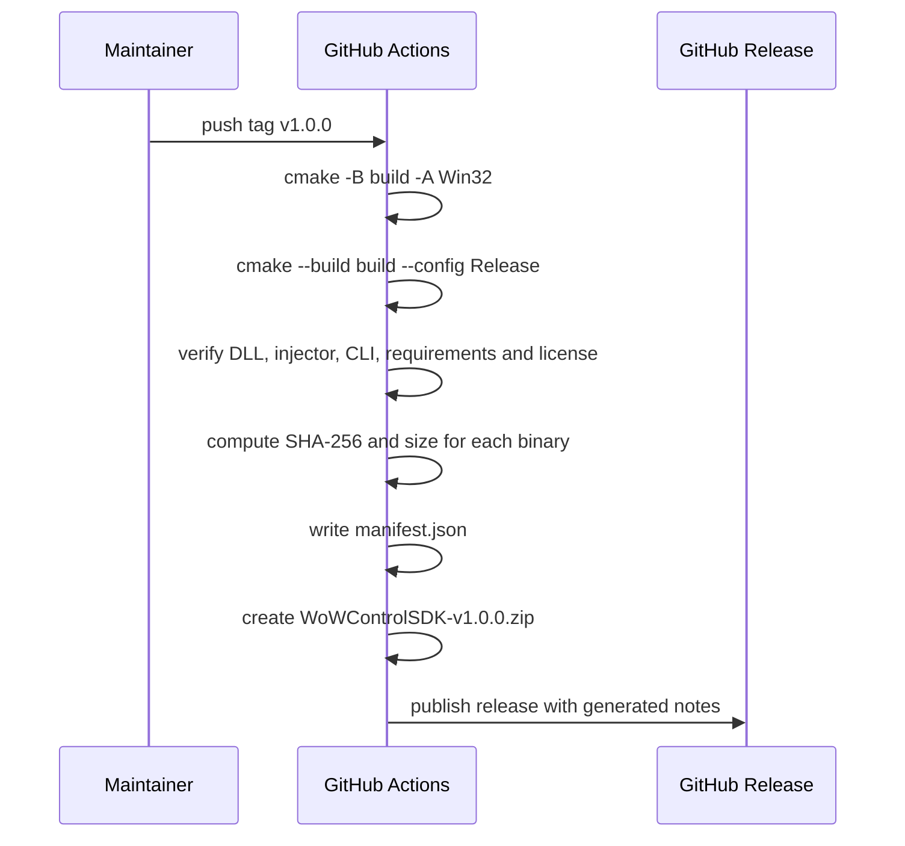

# Releases

A release is created by pushing a tag that starts with `v`. The `Build and Release` workflow builds the SDK on a Windows runner, verifies the artifacts, generates a manifest and publishes a GitHub Release.

## Trigger

```bash
git tag v1.0.0
git push origin v1.0.0
```

The tag name becomes the release version and the package name.

## Pipeline



| Step | What it does |
| --- | --- |
| Configure | Runs `cmake -B build -A Win32` |
| Build | Runs `cmake --build build --config Release` |
| Verify | Fails if `bin/release/WoWControlSDK.dll`, `bin/release/WowInjector.exe`, `tests/wowsdk_cli.py`, `requirements.txt` or `LICENSE` is missing |
| Manifest | Computes the SHA-256 hash and byte size of the DLL and the injector |
| Package | Creates `release/WoWControlSDK-<version>/` and compresses it to `WoWControlSDK-<version>.zip` |
| Publish | Creates the GitHub Release with generated notes and uploads the zip and `manifest.json` |

!!! note
    The verify step expects `requirements.txt` at the repository root. A release fails if that file is missing. Keep it in sync with the Python dependencies of the CLI.

## Package contents

```text
WoWControlSDK-<version>/
├── binaries/
│   ├── WoWControlSDK.dll
│   └── WowInjector.exe
├── wowsdk_cli.py
├── requirements.txt
├── LICENSE
└── manifest.json
```

## Manifest

The workflow writes `manifest.json` with this shape:

```json
{
  "schema_version": 1,
  "version": "v1.0.0",
  "commit": "<full commit SHA>",
  "artifacts": {
    "WoWControlSDK.dll": {
      "sha256": "<lowercase hex digest>",
      "size": 123456
    },
    "WowInjector.exe": {
      "sha256": "<lowercase hex digest>",
      "size": 654321
    }
  }
}
```

| Field | Description |
| --- | --- |
| `schema_version` | Manifest format version. Currently `1` |
| `version` | Tag name that triggered the release |
| `commit` | Commit SHA the tag points to |
| `artifacts` | Map of file name to hash and size |

## Verifying a download

Compare the hash of the downloaded binary with the manifest:

```powershell
Get-FileHash .\WoWControlSDK.dll -Algorithm SHA256
```

The resulting hash must match `artifacts["WoWControlSDK.dll"].sha256`.

## Local package

A local build produces the same binaries, but not the zip or the manifest. Run the build commands from [Building](building.md) and collect `bin/release/WoWControlSDK.dll` and `bin/release/WowInjector.exe` if a package is needed without GitHub Actions.

## Versioning

Tags are not tied to a version string inside the DLL. The `dll.getInfo` method reports the version compiled into the SDK, so keep both in sync when a release changes the public RPC surface.
