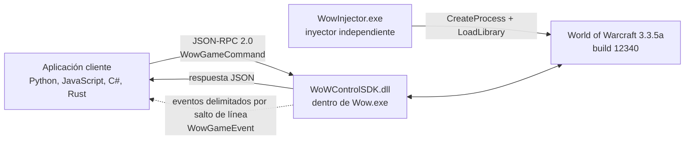
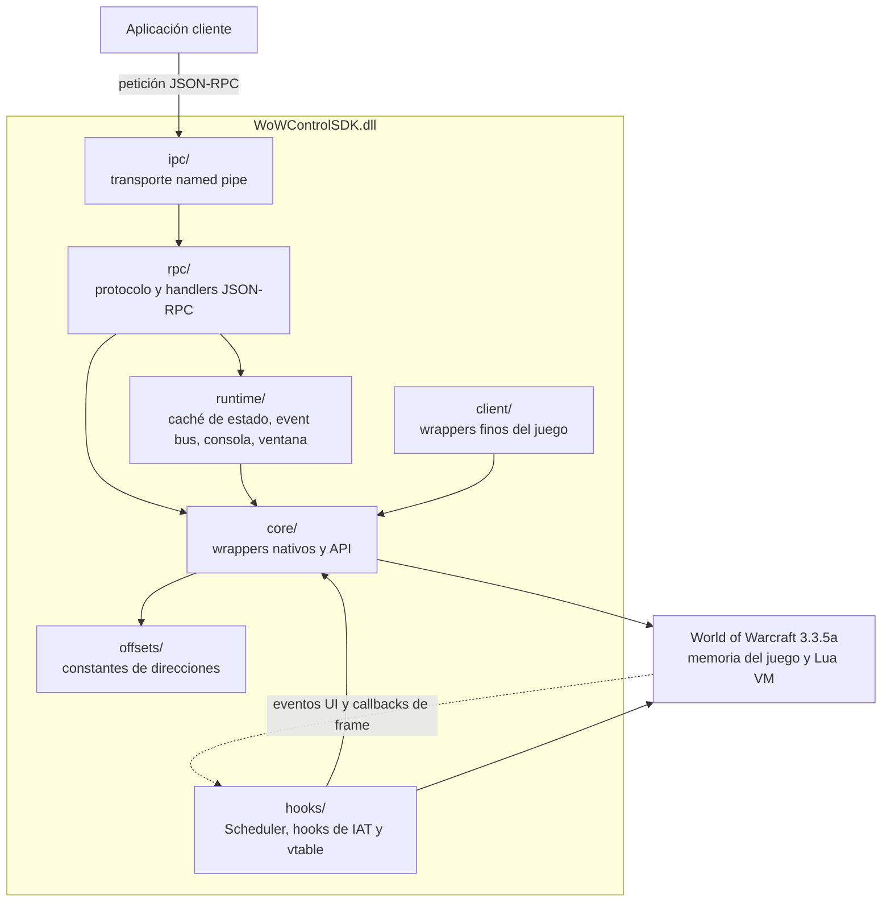
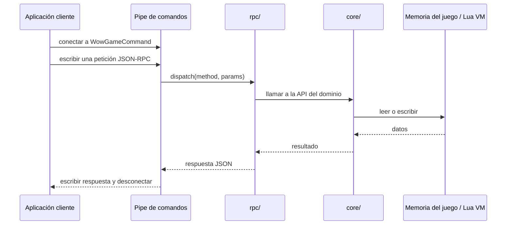
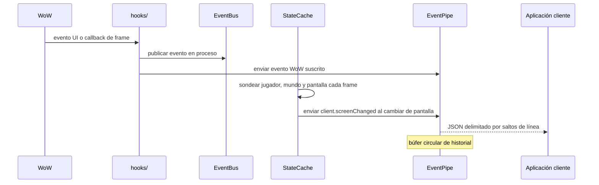

# Arquitectura

WoWControlSDK sigue una arquitectura estricta por capas. Cada capa tiene una responsabilidad definida y no debe invadir el dominio de otra. Todo el acceso a la memoria del juego se concentra en `core/`, lo que mantiene el protocolo, los servicios de runtime y los hooks independientes de las direcciones crudas.

## Componentes

| Componente | Responsabilidad | Se ejecuta en |
| --- | --- | --- |
| `WowInjector.exe` | Lanza `Wow.exe` suspendido, inyecta la DLL y espera el pipe de comandos | Proceso independiente |
| `WoWControlSDK.dll` | Hooks, acceso a memoria, puente Lua, servidor RPC y pipe de eventos | Proceso `Wow.exe` |
| Aplicación cliente | Envía peticiones JSON-RPC y consume respuestas y eventos | Cualquier proceso o lenguaje |

## Diseño por capas

### Responsabilidades de las capas

Todas las capas viven en `src/`. La raíz del repositorio conserva los archivos de compilación, `deps/`, `docs/` y `tools/`.

| Capa | Rol | Acceso a memoria del juego |
| --- | --- | --- |
| `injector/` | Ejecutable independiente que lanza WoW e inyecta la DLL | Ninguno |
| `ipc/` | Transporte named pipe y lectura/escritura de JSON crudo | Ninguno |
| `rpc/` | Parseo, dispatch, handlers y serialización JSON-RPC 2.0 | Ninguno |
| `runtime/` | Caché de estado, event bus, pipe de eventos, consola, captura de logs, lista de reinos y servicio de ventana | Ninguno directo; lee a través de `core/` |
| `hooks/` | Callbacks del scheduler del juego, hooks de IAT y de vtable y un breakpoint por registros de depuración. Nunca se parchea código del juego | Solo a través de `core/` y `offsets/` |
| `core/` | Wrappers nativos, capa API, lecturas y escrituras de memoria, resolvers | Sí, es la única capa autorizada |
| `client/` | Wrappers finos sobre `core/` y el Lua del juego para login, consola y errores | Direcciones mínimas |
| `offsets/` | Todas las direcciones y offsets de estructuras como `constexpr uintptr_t` | Solo constantes |

Los routers y handlers nunca leen memoria directamente. Llaman a las APIs de `core/` o leen la caché de `runtime/`, lo que mantiene testeable la capa de protocolo y reemplazable el diseño de memoria.

## Flujo de una petición

1. El cliente se conecta a `\\.\pipe\WowGameCommand`.
2. `ipc/CommandPipe` lee un mensaje de hasta 1 MiB.
3. `rpc/Dispatcher` valida el sobre y enruta la petición al handler registrado.
4. El handler llama a una API de `core/`, lee la caché de `runtime/` o encola trabajo en el hilo del juego.
5. `Dispatcher` envuelve el resultado del handler en una respuesta JSON-RPC.
6. `ipc/CommandPipe` escribe la respuesta, la vacía y desconecta al cliente.

El pipe de comandos atiende **una petición por conexión**. Los clientes deben abrir un handle nuevo para cada petición. El pipe de eventos es la conexión de larga duración.

## Flujo de eventos

1. WoW dispara un evento UI como `PLAYER_LOGIN` o `PLAYER_ENTERING_WORLD`.
2. El frame del puente Lua del SDK lo recibe mediante el propio despacho de eventos del juego.
3. Si el evento está suscrito con `events.subscribe`, se envía a `\\.\pipe\WowGameEvent`.
4. `StateCache` sondea el estado del jugador, el mundo y la pantalla en cada frame.
5. Cuando cambia la pantalla glue, `StateCache` envía `client.screenChanged`.
6. Los hooks de carga envían `loading.startup`, `loading.progress`, `loading.finished` y `loading.cancelled`.

Los eventos también se guardan en un búfer circular que `events.getHistory` puede leer. El pipe de eventos acepta un cliente externo a la vez y escribe un objeto JSON por línea.

## Modelo de hilos

| Hilo | Rol |
| --- | --- |
| Hilo del juego (main/frame) | Ejecuta el bucle de frames de WoW. El SDK se ejecuta en él mediante un handler idle registrado en el scheduler del juego. Los callbacks de hooks y `StateCache::update()` se ejecutan aquí. Las lecturas de memoria ocurren en este hilo. |
| Hilo del pipe RPC | Acepta conexiones del pipe de comandos, lee una petición y la despacha. Bloquea en `ReadFile`. |
| Hilo del pipe de eventos | Acepta un cliente del pipe de eventos y bloquea en `WriteFile` mientras envía eventos. |
| Hilo de inicialización de la DLL | Se inicia desde `DllMain` e inicializa logging, hooks, motor Lua, runtime y pipes. |
| Ejecución de handlers RPC | Algunos handlers encolan trabajo en el hilo del juego mediante `Hooks::Frame::Execute`; otros bloquean el hilo RPC mientras sondean. |

!!! note
    Todos los métodos `lua.*` se ejecutan en el hilo del juego: el hilo RPC pasa la llamada al siguiente frame y espera su resultado. Las operaciones que cambian estado, como login, logout y entrar al mundo, se encolan en el hilo del juego para evitar condiciones de carrera.

## Aislamiento de offsets

Todas las direcciones del juego, punteros a función y offsets de estructuras se definen como `constexpr uintptr_t` en `offsets/Offsets*.h`. No aparece ningún literal `0x...` fuera de esa carpeta. Los archivos fuente referencian las constantes como `Offsets::Namespace::CONSTANT`.

| Archivo | Contenido |
| --- | --- |
| `OffsetsClient.h` | Estado del cliente, net client y flag de dentro del mundo |
| `OffsetsConsole.h` | Funciones de CVar y lista de líneas de consola |
| `OffsetsFrame.h` | Scheduler del juego y vtables del dispositivo gráfico |
| `OffsetsGroup.h` | Estructuras de grupo y raid |
| `OffsetsLoading.h` | Estado y progreso de la pantalla de carga y tablas `Map` / `LoadingScreens` |
| `OffsetsLogin.h` | Autenticación, logout y lista de personajes |
| `OffsetsLua.h` | Estado de Lua y tabla de eventos |
| `OffsetsMap.h` | Conversión de posición de mapa |
| `OffsetsObjectMgr.h` | Object manager |
| `OffsetsPlayer.h` | Offsets específicos del jugador |
| `OffsetsUnit.h` | Estructura de unidad, movimiento y auras |

## Sistema de eventos

El sistema tiene dos capas independientes.

**EventBus** (`runtime/events/EventBus.h`) es el bus de publicación y suscripción en proceso. `StateCache` lo usa para emitir eventos como `player.healthChanged` y `world.zoneChanged`. Hoy ningún componente interno se suscribe a esos eventos; el bus queda disponible para uso futuro dentro del proceso.

**EventPipe** (`runtime/events/EventPipe.h`) es el flujo externo en `\\.\pipe\WowGameEvent`. `StateCache` escribe `client.screenChanged` y `LoadingHooks` escribe los eventos de carga. Los eventos UI de WoW suscritos los escribe `runtime/events/LuaEventBridge`, que los recibe del frame del puente Lua. También entrega los eventos sociales, de comercio, de duelo, de colas y de susurros a `runtime/events/GameEventBridge`, que lee los datos relacionados a través de `core/api/` y escribe los eventos `friends.*`, `group.invite*`, `summon.*`, `lfg.*`, `trade.*`, `duel.*`, `battlefield.*` y `chat.whisperReceived`. El puente Lua engancha las funciones de invitación, invocación, comercio y duelo con `hooksecurefunc`, así que también se informan las respuestas dadas en el juego. El pipe funciona en modo byte y separa los mensajes con un salto de línea.

Los eventos que llegan al pipe se dividen en dos grupos:

| Grupo | Eventos |
| --- | --- |
| Eventos del SDK, enviados automáticamente | `client.screenChanged`, `loading.startup`, `loading.progress`, `loading.finished`, `loading.cancelled` |
| Eventos UI de WoW, enviados tras `events.subscribe` | `PLAYER_LOGIN`, `PLAYER_ENTERING_WORLD`, `UNIT_HEALTH`, `ZONE_CHANGED` y cualquier otro evento disparado por `FrameScript_SignalEvent` |

El historial es un búfer circular de 256 entradas por defecto. `events.getHistory`, `events.clearHistory` y `events.setMaxBuffer` lo gestionan, y las mismas entradas se escriben en el pipe cuando hay un cliente conectado.

## Caché de estado

`runtime/state/StateCache` actualiza el estado del jugador, el mundo y la pantalla una vez por frame. Los dominios `player.*` y `world.*` leen esa caché en lugar de encolar una petición en el hilo del juego, por lo que responden rápido y con el mismo coste independientemente de la carga del juego. Los datos de grupo se leen de las tablas de grupo del cliente en el hilo del juego en cada llamada, así que siempre reflejan los últimos valores enviados por el servidor.
