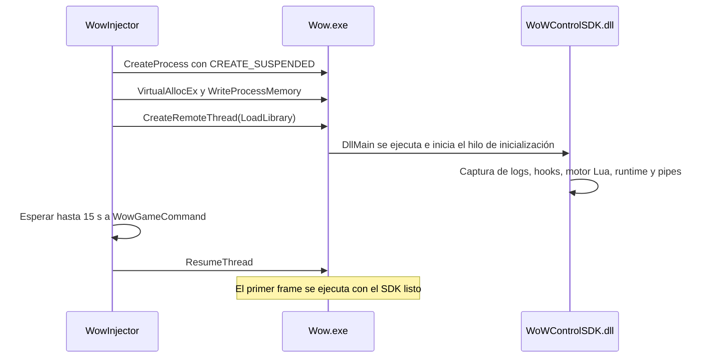

# Inyección

WoWControlSDK incluye `WowInjector.exe`, un inyector independiente que lanza `Wow.exe`, inyecta la DLL y sincroniza el arranque para que el SDK esté completamente inicializado antes del primer frame del juego.

## Flujo congelar-sincronizar



1. **Lanzamiento suspendido.** `Wow.exe` arranca con `CREATE_SUSPENDED`, así que no se ejecuta código del juego.
2. **Inyección de la DLL.** El inyector reserva memoria en el proceso destino, escribe la ruta de la DLL y llama a `LoadLibrary` mediante `CreateRemoteThread`.
3. **Inicialización del SDK.** `DllMain` inicia un hilo dedicado que prepara la captura de logs, los hooks, el motor Lua, el runtime, el pipe de comandos y el pipe de eventos.
4. **Espera del pipe.** El juego permanece congelado mientras el inyector espera hasta 15 segundos a que `\\.\pipe\WowGameCommand` acepte una conexión. Si el juego se cierra durante la espera, el inyector se detiene de inmediato.
5. **Configuración de la autenticación.** El inyector registra el token de sesión (o `--no-auth`) con `auth.init` mientras el juego sigue congelado. Si el SDK lo rechaza, el juego se cierra.
6. **Reanudación del juego.** El inyector reanuda el hilo principal y el juego continúa con normalidad.

Este orden elimina la carrera entre el primer frame y la instalación de los hooks, y evita perder eventos de arranque.

## Uso

```bash
echo %ZFORGE_TOKEN% | WowInjector.exe --wow "C:\World of Warcraft\Wow.exe" --dll "bin\release\WoWControlSDK.dll" --token-stdin
```

### Argumentos

| Argumento | Descripción |
| --- | --- |
| `--wow <path>` | Ruta a `Wow.exe`. Obligatorio. |
| `--dll <path>` | Ruta a `WoWControlSDK.dll`. Obligatorio. |
| `--token-stdin` | Lee el token de sesión (32 a 128 caracteres hexadecimales) de la entrada estándar. Obligatorio salvo que se use `--no-auth`. |
| `--no-auth` | Desactiva la autenticación. Solo para herramientas de desarrollo. |
| `--pipe <name>` | Named pipe que se espera antes de descongelar. Por defecto, `WowGameCommand`. |
| `--no-pipe` | Descongela tras `--wait` milisegundos en lugar de esperar el pipe. |
| `--wait <ms>` | Milisegundos a esperar cuando `--no-pipe` está activo. Por defecto, `500`. |
| `--kill` | Mata un proceso `Wow.exe` existente antes de lanzar. |
| `--hidden` | Mantiene oculta la ventana del juego hasta [`window.show`](methods/window.md#windowsetstarthidden), para lanzamientos headless. Se envía con el juego todavía congelado; no se puede combinar con `--no-pipe`. |
| `--wow-args <str>` | Argumentos extra para `Wow.exe`. |
| `--pipe-cmd <json>` | Envía un comando JSON-RPC cuando el pipe está listo. Repetible. El token de sesión se añade a cada comando automáticamente. |

### Ejemplo con opciones

El siguiente ejemplo mata cualquier cliente en ejecución, inicia uno nuevo y alterna la consola del juego después de la inicialización:

```cmd
WowInjector.exe ^
    --wow "C:\World of Warcraft\Wow.exe" ^
    --dll "C:\WoWControlSDK\bin\release\WoWControlSDK.dll" ^
    --kill ^
    --no-auth ^
    --pipe-cmd "{\"jsonrpc\":\"2.0\",\"method\":\"dll.toggleConsole\",\"id\":1}"
```

!!! tip
    El flujo congelar-sincronizar es el método de inyección recomendado. Garantiza que la DLL y sus pipes estén listos antes de cualquier frame, y que los eventos de arranque se puedan capturar.

## Inyección alternativa

Se puede usar cualquier inyector de DLL, como [Cheat Engine](https://www.cheatengine.org/). Cuando el juego ya está en ejecución:

- La DLL se inicializa de forma asíncrona.
- Los hooks se enganchan durante el siguiente frame.
- El pipe de comandos aparece poco después de la inyección.
- Los eventos disparados entre el arranque del juego y la inyección se pierden.
- El primer cliente que llame a `auth.init` configura la autenticación.

El SDK no depende del inyector incluido. El inyector solo automatiza el lanzamiento, la inyección y la sincronización del pipe.

## Comandos de arranque

`--pipe-cmd` encola comandos JSON-RPC que se ejecutan en cuanto el SDK se inicializa. Los comandos se envían en orden y cada uno espera su respuesta antes de enviar el siguiente.

```cmd
WowInjector.exe --wow "..." --dll "..." ^
    --pipe-cmd "{\"jsonrpc\":\"2.0\",\"method\":\"dll.setLogConfig\",\"params\":{\"showInConsole\":true},\"id\":1}" ^
    --pipe-cmd "{\"jsonrpc\":\"2.0\",\"method\":\"dll.toggleConsole\",\"id\":2}"
```

Los comandos seguros al arrancar son `dll.toggleConsole`, `dll.setLogConfig` y `dll.getInfo`. Los comandos que dependen del juego, como `lua.*`, `client.login` y `unit.*`, deben esperar a que el jugador llegue a la pantalla adecuada.

## Pipe de eventos

Además del pipe de comandos, el SDK abre `\\.\pipe\WowGameEvent` para transmitir eventos. El SDK es el servidor y escribe JSON delimitado por saltos de línea; el cliente se conecta y lee el flujo hasta desconectarse. Solo se acepta un cliente de eventos a la vez.

```python
import json

import win32file

pipe = win32file.CreateFile(
    r"\\.\pipe\WowGameEvent",
    win32file.GENERIC_READ,
    0,
    None,
    win32file.OPEN_EXISTING,
    0,
    None,
)

try:
    buffer = ""
    while True:
        _, data = win32file.ReadFile(pipe, 65536)
        buffer += data.decode("utf-8", errors="replace")
        while "\n" in buffer:
            line, buffer = buffer.split("\n", 1)
            if line.strip():
                print(json.loads(line))
finally:
    win32file.CloseHandle(pipe)
```

Consulta [events.*](methods/events.md) para los eventos disponibles y el listener del CLI.

## Solución de problemas

| Síntoma | Causa y solución |
| --- | --- |
| El inyector termina tras 15 segundos | El pipe nunca apareció. Comprueba la ruta de la DLL y que la DLL corresponda a la build del cliente. |
| Cualquier error del inyector | El inyector cierra el juego que inició, así que un inicio fallido nunca deja un `Wow.exe` suspendido. |
| El juego se queda suspendido | El inyector sigue esperando el pipe. Ejecuta con `--no-pipe --wait 1000` para omitir la espera y diagnosticar. |
| `LoadLibrary` falla | Falta una dependencia de la DLL o la arquitectura del proceso no coincide. Compila con la configuración de CMake incluida. |
| No llegan eventos | El pipe de eventos acepta un cliente. Desconecta otros listeners y suscríbete a los eventos necesarios. |
| Faltan eventos anteriores a la inyección | Usa el inyector incluido con congelar-sincronizar o acepta que los eventos tempranos se pierden con un inyector de terceros. |
