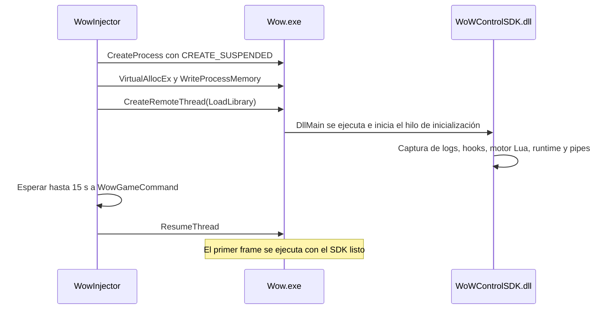

# Inyección

WoWControlSDK incluye `WowInjector.exe`, un inyector independiente que lanza `Wow.exe`, inyecta la DLL y sincroniza el arranque para que el SDK esté completamente inicializado antes del primer frame del juego.

## Flujo congelar-sincronizar



1. **Lanzamiento suspendido.** `Wow.exe` arranca con `CREATE_SUSPENDED`, así que no se ejecuta código del juego.
2. **Inyección de la DLL.** El inyector reserva memoria en el proceso destino, escribe la ruta de la DLL y llama a `LoadLibrary` mediante `CreateRemoteThread`.
3. **Inicialización del SDK.** `DllMain` inicia un hilo dedicado que prepara la captura de logs, los hooks, el motor Lua, el runtime, el pipe de comandos y el pipe de eventos.
4. **Espera del pipe.** El juego permanece congelado mientras el inyector espera hasta 15 segundos a que `\\.\pipe\WowGameCommand` acepte una conexión. Si el juego se cierra durante la espera, el inyector se detiene de inmediato.
5. **Configuración de la autenticación.** El inyector registra el token de sesión (o `--no-auth`) con `auth.init` mientras el juego sigue congelado. Si el SDK lo rechaza, el juego se cierra.
6. **Reanudación del juego.** El inyector reanuda el hilo principal y el juego continúa con normalidad.

Este orden elimina la carrera entre el primer frame y la instalación de los hooks, y evita perder eventos de arranque.

## Uso

Genera un token aleatorio de 32 a 128 caracteres hexadecimales para cada sesión de juego —por ejemplo con `python -c "import secrets; print(secrets.token_hex(32))"`— y pásalo por la entrada estándar. Conserva ese token: es el valor que tu cliente envía en el campo `auth` de cada comando y en el saludo del pipe de eventos.

```bash
echo %WOW_SDK_TOKEN% | WowInjector.exe --wow "C:\World of Warcraft\Wow.exe" --dll "bin\release\WoWControlSDK.dll" --token-stdin
```

Usa `--no-auth` en su lugar para herramientas de desarrollo locales. Registra `{"disabled": true}` y permite que cualquier proceso de tu usuario de Windows controle el juego sin token.

### Argumentos

| Argumento | Descripción |
| --- | --- |
| `--wow <path>` | Ruta a `Wow.exe`. Obligatorio. |
| `--dll <path>` | Ruta a `WoWControlSDK.dll`. Obligatorio. |
| `--token-stdin` | Lee el token de sesión (32 a 128 caracteres hexadecimales) de la entrada estándar. Obligatorio salvo que se use `--no-auth`. |
| `--no-auth` | Desactiva la autenticación. Solo para herramientas de desarrollo. |
| `--pipe <name>` | Named pipe que se espera antes de descongelar. Por defecto, `WowGameCommand`. |
| `--no-pipe` | Descongela tras `--wait` milisegundos en lugar de esperar el pipe. |
| `--wait <ms>` | Milisegundos a esperar cuando `--no-pipe` está activo. Por defecto, `500`. |
| `--kill` | Mata un proceso `Wow.exe` existente antes de lanzar. |
| `--hidden` | Mantiene oculta la ventana del juego hasta [`window.show`](methods/window.md#windowsetstarthidden), para lanzamientos headless. Se envía con el juego todavía congelado; no se puede combinar con `--no-pipe`. |
| `--manual-map` | Mapea la DLL en memoria en lugar de usar `LoadLibrary`. Consulta [Manual map](#manual-map). |
| `--wow-args <str>` | Argumentos extra para `Wow.exe`. |
| `--pipe-cmd <json>` | Envía un comando JSON-RPC cuando el pipe está listo. Repetible. El token de sesión se añade a cada comando automáticamente. |
| `--call <method>` | Carga la DLL sin iniciar el juego e imprime la respuesta de un método que funciona fuera de él. Solo necesita `--dll`. Consulta [Leer la DLL sin el juego](#leer-la-dll-sin-el-juego). |

### Ejemplo con opciones

El siguiente ejemplo mata cualquier cliente en ejecución, inicia uno nuevo y alterna la consola del juego después de la inicialización:

```cmd
WowInjector.exe ^
    --wow "C:\World of Warcraft\Wow.exe" ^
    --dll "C:\WoWControlSDK\bin\release\WoWControlSDK.dll" ^
    --kill ^
    --no-auth ^
    --pipe-cmd "{\"jsonrpc\":\"2.0\",\"method\":\"dll.toggleConsole\",\"id\":1}"
```

!!! tip
    El flujo congelar-sincronizar es el método de inyección recomendado. Garantiza que la DLL y sus pipes estén listos antes de cualquier frame, y que los eventos de arranque se puedan capturar.

## Inyección alternativa

Se puede usar cualquier inyector de DLL, como [Cheat Engine](https://www.cheatengine.org/). Cuando el juego ya está en ejecución:

- La DLL se inicializa de forma asíncrona.
- Los hooks se enganchan durante el siguiente frame.
- El pipe de comandos aparece poco después de la inyección.
- Los eventos disparados entre el arranque del juego y la inyección se pierden.
- El primer cliente que llame a `auth.init` configura la autenticación.

El SDK no depende del inyector incluido. El inyector solo automatiza el lanzamiento, la inyección y la sincronización del pipe.

## Manual map (experimental)

`--manual-map` es una opción experimental: carga `WoWControlSDK.dll` sin pasar por `LoadLibrary`. El inyector lee el archivo PE, reserva `SizeOfImage` bytes en el proceso del juego, copia las cabeceras y las secciones, aplica las relocaciones `IMAGE_REL_BASED_HIGHLOW`, carga cada dependencia dentro del juego y resuelve la IAT, ajusta las protecciones de cada sección y llama al punto de entrada con `DLL_PROCESS_ATTACH`. El flujo congelar-sincronizar no cambia: el pipe y `auth.init` se esperan antes de `ResumeThread`.

```cmd
WowInjector.exe --wow "C:\World of Warcraft\Wow.exe" --dll "bin\release\WoWControlSDK.dll" --manual-map --no-auth
```

La DLL no se registra en las listas de módulos del PEB, así que `LoadLibrary` y `GetModuleHandle` no la encuentran por nombre. La imagen existe solo en la memoria del juego y se descarta al terminar el proceso. El inyector también ofrece `injectManualMapFromBuffer` para cargar una imagen PE desde un buffer en memoria, sin escribir un archivo temporal en disco.

### Limitaciones conocidas

- **Solo x86.** Se admiten imágenes PE32 y relocaciones `HIGHLOW`; los demás tipos se omiten. Si la base preferida no está libre, la DLL necesita tabla de relocaciones.
- **Imports.** Cada DLL importada se carga también en el proceso del juego, porque resolver solo en el inyector deja direcciones que pueden no existir en el destino. Cuando un módulo tiene la misma base en ambos procesos se reutiliza `GetProcAddress` local; si las bases difieren, la resolución se hace dentro del juego. Las DLL del sistema suelen coincidir; una DLL de terceros con ASLR ya no rompe la IAT.
- **TLS.** Si la DLL tiene directorio TLS, se reserva un índice con `TlsAlloc` en el proceso destino y se ejecutan los callbacks de `DLL_PROCESS_ATTACH` antes del punto de entrada. Los callbacks corren en un hilo creado por el inyector, no en el hilo principal del juego; no se reciben `DLL_THREAD_ATTACH` ni `DLL_THREAD_DETACH` para hilos posteriores, ni `DLL_PROCESS_DETACH`, porque la imagen nunca se descarga.
- **Sin desinstalación.** No hay un equivalente a `FreeLibrary`: la imagen mapeada permanece hasta que termina el proceso.
- `--manual-map` no afecta a `--call`: ese modo sigue cargando la DLL en el inyector con `LoadLibraryA`.
- Si el mapeo falla, el inyector avisa y reintenta con `LoadLibrary`, para no cerrar el juego. En clientes que protegen los DLL del CRT (como algunos `Wow.exe` 3.3.5a), los hilos que crea el SDK pueden fallar al inicializar la tabla `_onexit` del CRT; en ese caso se usa la vía clásica.

Si la DLL usa `GetModuleHandle` sobre su propio nombre, obtendrá `NULL`: al no estar en el PEB, el módulo no existe para el loader.

## Comandos de arranque

`--pipe-cmd` encola comandos JSON-RPC que se ejecutan en cuanto el SDK se inicializa. Los comandos se envían en orden y cada uno espera su respuesta antes de enviar el siguiente.

```cmd
echo %WOW_SDK_TOKEN% | WowInjector.exe --wow "..." --dll "..." ^
    --token-stdin ^
    --pipe-cmd "{\"jsonrpc\":\"2.0\",\"method\":\"dll.setLogConfig\",\"params\":{\"showInConsole\":true},\"id\":1}" ^
    --pipe-cmd "{\"jsonrpc\":\"2.0\",\"method\":\"dll.toggleConsole\",\"id\":2}"
```

El inyector necesita el token incluso cuando solo se usan comandos de arranque. Con `--no-auth`, omite la tubería y la opción `--token-stdin`.

Los comandos seguros al arrancar son `dll.toggleConsole`, `dll.setLogConfig` y `dll.getInfo`. Los comandos que dependen del juego, como `lua.*`, `client.login` y `unit.*`, deben esperar a que el jugador llegue a la pantalla adecuada.

## Leer la DLL sin el juego

`--call <method>` carga la DLL en el proceso del inyector, sin iniciar el juego, llama a un método que funciona fuera de él e imprime la respuesta JSON-RPC. Solo hace falta `--dll`; `--wow` y las opciones de autenticación se ignoran. El código de salida es `0` cuando la respuesta no tiene error.

```powershell
.\WowInjector.exe --dll .\WoWControlSDK.dll --call dll.getInfo
```

```json
{"id":1,"jsonrpc":"2.0","result":{"commit":{"date":"2026-11-19T12:55:26-05:00","dirty":false,"hash":"4f09723ebef967c9c66e5ed16a19eb7a42a14d97","shortHash":"4f09723","timestamp":1795110926},"inGame":false,"version":"2.3.0"}}
```

Solo está disponible [`dll.getInfo`](methods/dll.md#leer-la-dll-sin-el-juego). Es la forma de que un programa de 64 bits, como un launcher, sepa qué build de la DLL va a inyectar.

## Pipe de eventos

Además del pipe de comandos, el SDK abre `\\.\pipe\WowGameEvent` para transmitir eventos. El SDK es el servidor y escribe JSON delimitado por saltos de línea; el cliente se conecta y lee el flujo hasta desconectarse. Solo se acepta un cliente de eventos a la vez.

Cuando la autenticación está activada, el cliente debe enviar el saludo `{"auth":"<token>"}` seguido de un salto de línea en cuanto se conecte. El SDK responde con un evento de control `auth.ok` y empieza a transmitir, o con `auth.failed` y cierra la conexión. El saludo debe llegar en 5 segundos. Con `--no-auth` no hace falta el saludo.

```python
import json
import os

import win32file

TOKEN = os.environ["WOW_SDK_TOKEN"]

pipe = win32file.CreateFile(
    r"\\.\pipe\WowGameEvent",
    win32file.GENERIC_READ | win32file.GENERIC_WRITE,
    0,
    None,
    win32file.OPEN_EXISTING,
    0,
    None,
)

try:
    win32file.WriteFile(pipe, (json.dumps({"auth": TOKEN}) + "\n").encode("utf-8"))

    buffer = ""
    while True:
        _, data = win32file.ReadFile(pipe, 65536)
        buffer += data.decode("utf-8", errors="replace")
        while "\n" in buffer:
            line, buffer = buffer.split("\n", 1)
            if line.strip():
                print(json.loads(line))
finally:
    win32file.CloseHandle(pipe)
```

Consulta [events.*](methods/events.md) para los eventos disponibles y el listener del CLI.

## Solución de problemas

| Síntoma | Causa y solución |
| --- | --- |
| El inyector termina tras 15 segundos | El pipe nunca apareció. Comprueba la ruta de la DLL y que la DLL corresponda a la build del cliente. |
| Cualquier error del inyector | El inyector cierra el juego que inició, así que un inicio fallido nunca deja un `Wow.exe` suspendido. |
| El juego se queda suspendido | El inyector sigue esperando el pipe. Ejecuta con `--no-pipe --wait 1000` para omitir la espera y diagnosticar. |
| `LoadLibrary` falla | Falta una dependencia de la DLL o la arquitectura del proceso no coincide. Compila con la configuración de CMake incluida. |
| No llegan eventos | El pipe de eventos acepta un cliente. Desconecta otros listeners y suscríbete a los eventos necesarios. |
| El cliente de eventos es rechazado con `auth.failed` | Falta el saludo, llega tarde (más de 5 segundos) o lleva un token incorrecto. Envía `{"auth":"<token>"}` seguido de un salto de línea justo después de conectar. |
| `auth.init rejected` / el juego se cierra al lanzar | El token no tiene entre 32 y 128 caracteres hexadecimales, o otro cliente ya configuró la autenticación. |
| Faltan eventos anteriores a la inyección | Usa el inyector incluido con congelar-sincronizar o acepta que los eventos tempranos se pierden con un inyector de terceros. |
