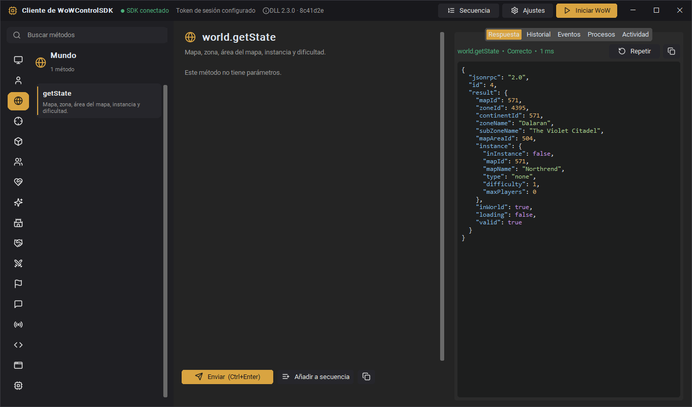
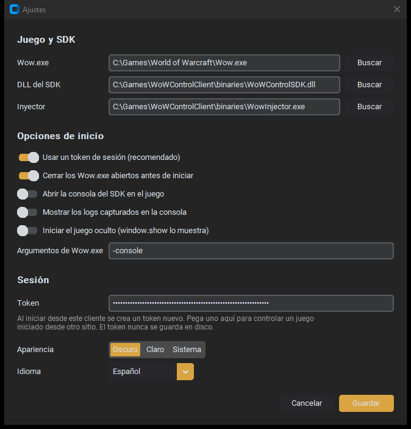
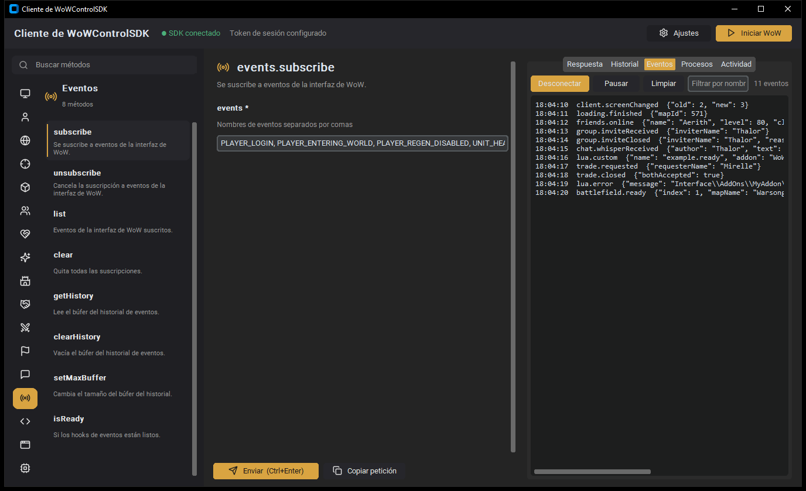

# Cliente de escritorio

WoWControl Client es una aplicación de escritorio para llamar a todos los métodos del SDK y ver sus eventos. Inicia el juego con el inyector y un token de sesión, crea un formulario para cada método, muestra la respuesta JSON y guarda un historial de llamadas. Resulta útil para pruebas manuales, para inspeccionar respuestas y como referencia para una integración propia.



## Descarga

Cada versión incluye `WoWControlClient-<versión>.zip` junto al paquete del SDK. Descomprímelo donde quieras y ejecuta `WoWControlClient.exe`. La carpeta ya contiene `binaries/WoWControlSDK.dll` y `binaries/WowInjector.exe`, así que solo hay que indicar la ruta de `Wow.exe`.

El cliente se compila como carpeta (`WoWControlClient.exe` más `_internal/`) en lugar de un único ejecutable, así que arranca rápido y no se descomprime en una carpeta temporal en cada ejecución. Mantén la carpeta completa.

## Ejecutar desde el código

| Herramienta | Versión | Uso |
| --- | --- | --- |
| Python | 3.10 o posterior | Ejecuta el cliente |
| customtkinter | 6.0.0 | Interfaz |
| pywin32 | 312 | Acceso a los named pipes |

```bash
pip install -r requirements.txt
cd tools
python -m wowsdk_client
```

Desde el código, el cliente usa `bin/release/WoWControlSDK.dll` y `bin/release/WowInjector.exe` del repositorio cuando existen.

## Compilación

```bash
pip install -r requirements-build.txt
pyinstaller --noconfirm --clean --windowed --onedir --name WoWControlClient --paths tools --collect-data customtkinter --distpath dist --workpath build/pyinstaller --specpath build/pyinstaller tools/run_client.py
```

El cliente se genera en `dist/WoWControlClient/`. `--windowed` oculta la ventana de consola y `--onedir` mantiene el formato de carpeta. El workflow de CI ejecuta el mismo comando en cada pull request y sube la carpeta como artefacto.

## Ventana

| Zona | Contenido |
| --- | --- |
| Cabecera | Estado del SDK (si existe el pipe de comandos), estado del token de sesión, **Settings** y **Launch WoW** |
| Barra lateral | Todos los métodos agrupados por dominio, con un buscador que compara nombres y descripciones |
| Formulario | El método seleccionado con un campo por parámetro: texto, contraseña, número, interruptor, lista, código Lua o JSON. Los parámetros obligatorios llevan `*` |
| Response | La respuesta JSON con colores, el estado de la llamada y lo que tardó |
| History | Las últimas 100 llamadas; al seleccionar una se muestran su petición y su respuesta |
| Events | Vista en vivo del pipe de eventos con filtro por nombre, pausa y limpieza |
| Activity | Salida del inyector, estado del pipe de eventos y mensajes del cliente |


Pulsa **Send** o `Ctrl+Enter` para enviar la petición. Las llamadas se ejecutan en un hilo aparte, así que los métodos lentos como `client.login` o `client.enterWorld` no congelan la ventana. **Copy request** copia la petición JSON con el token sustituido por un marcador. `client.quit` pide confirmación.

## Ajustes

| Ajuste | Descripción |
| --- | --- |
| Wow.exe | Ruta del ejecutable del juego |
| SDK DLL e Injector | Rutas de `WoWControlSDK.dll` y `WowInjector.exe`. Si están vacías se usan las incluidas o las compiladas |
| Use a session token | Lanza con `--token-stdin` y un token nuevo por sesión (recomendado). Si está desactivado, el cliente lanza con `--no-auth` |
| Close running Wow.exe before launching | Pasa `--kill` al inyector |
| Open the in-game SDK console | Envía `dll.toggleConsole` cuando el SDK está listo |
| Show captured logs in the console | Envía `dll.setLogConfig` con `showInConsole` |
| Wow.exe arguments | Se pasan con `--wow-args`; `-console` por defecto |
| Token | Token que se usa en las peticiones y en el pipe de eventos. Pega uno para controlar un juego iniciado desde otro programa |
| Appearance | Tema oscuro, claro o del sistema |



Los ajustes se guardan en `%APPDATA%\WoWControlClient\settings.json`. El token de sesión solo se guarda en memoria y nunca se escribe en disco.

## Lanzar el juego

**Launch WoW** genera un token hexadecimal de 64 caracteres, inicia el inyector sin ventana de consola y le escribe el token por la entrada estándar, así que el token nunca aparece en una línea de comandos. La salida del inyector, incluido el id del proceso del juego, aparece en **Activity**. A partir de ahí, cada petición lleva el token en su campo `auth`.

## Eventos en vivo

**Events → Connect** abre `\\.\pipe\WowGameEvent`, envía el saludo de autenticación y lista cada evento con su hora, nombre y argumentos. El filtro compara los nombres de los eventos, por ejemplo `trade.` o `UNIT_`.



El pipe de eventos acepta un cliente a la vez. Si otro programa, como un launcher, está conectado, el cliente avisa de que el pipe está ocupado.

!!! tip
    Los eventos del SDK como `client.screenChanged`, `loading.*`, `group.inviteReceived` o `trade.requested` se envían siempre. Los eventos UI de WoW solo aparecen después de `events.subscribe`.

## Añadir métodos

El cliente construye todos los formularios a partir de `tools/wowsdk_client/catalog.py`. Para dar soporte a un método nuevo del SDK, añade una entrada `Method` con sus parámetros al `Domain` correspondiente; no hace falta tocar la interfaz.

| Módulo | Responsabilidad |
| --- | --- |
| `catalog.py` | Métodos, parámetros y su tipo de campo |
| `transport.py` | Una petición JSON-RPC por conexión al pipe de comandos, con el campo `auth` |
| `events.py` | Lector del pipe de eventos en un hilo aparte |
| `launcher.py` | Línea de comandos del inyector, generación del token y reenvío de su salida |
| `settings.py` | Archivo de ajustes y búsqueda de los binarios incluidos |
| `ui/` | Ventana, barra lateral, formulario de método, vista JSON, panel de eventos y diálogo de ajustes |
