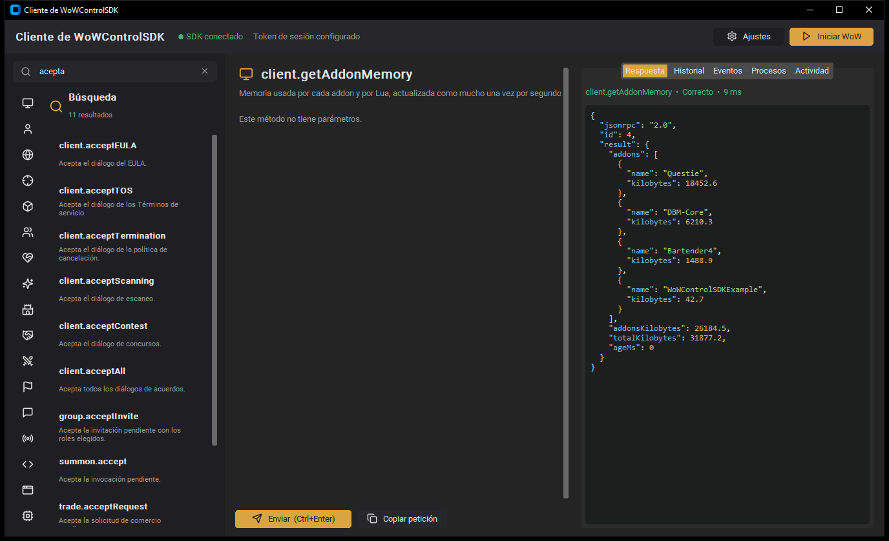
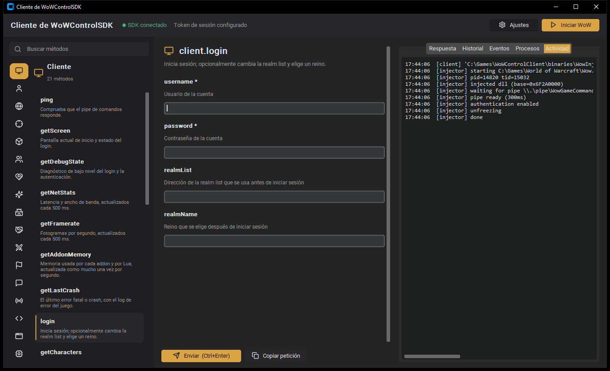
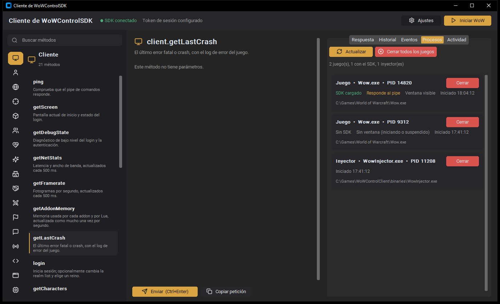

# Cliente de escritorio

WoWControl Client es una aplicación de escritorio para llamar a todos los métodos del SDK y ver sus eventos. Inicia el juego con el inyector y un token de sesión, crea un formulario para cada método, muestra la respuesta JSON, guarda un historial de llamadas y lista los juegos en ejecución. Resulta útil para pruebas manuales, para inspeccionar respuestas y como referencia para una integración propia.

La interfaz está disponible en español e inglés.


## Descarga

Cada versión incluye `WoWControlClient-<versión>.zip` junto al paquete del SDK. Descomprímelo donde quieras y ejecuta `WoWControlClient.exe`. La carpeta ya contiene `binaries/WoWControlSDK.dll` y `binaries/WowInjector.exe`, así que solo hay que indicar la ruta de `Wow.exe`.

El cliente se compila como carpeta (`WoWControlClient.exe` más `_internal/`) en lugar de un único ejecutable, así que arranca rápido y no se descomprime en una carpeta temporal en cada ejecución. Mantén la carpeta completa.

## Ejecutar desde el código

| Herramienta | Versión | Uso |
| --- | --- | --- |
| Python | 3.10 o posterior | Ejecuta el cliente |
| customtkinter | 6.0.0 | Interfaz |
| pywin32 | 312 | Named pipes y procesos |
| Pillow | 12.2.0 | Iconos |

```bash
pip install -r requirements.txt
cd tools
python -m wowsdk_client
```

Desde el código, el cliente usa `bin/release/WoWControlSDK.dll` y `bin/release/WowInjector.exe` del repositorio cuando existen.

## Compilación

```bash
pip install -r requirements-build.txt
pyinstaller --noconfirm --clean --windowed --onedir --name WoWControlClient --paths tools --collect-data customtkinter --collect-data wowsdk_client --distpath dist --workpath build/pyinstaller --specpath build/pyinstaller tools/run_client.py
```

El cliente se genera en `dist/WoWControlClient/`. `--windowed` oculta la ventana de consola, `--onedir` mantiene el formato de carpeta y `--collect-data wowsdk_client` incluye el catálogo de métodos, las traducciones y los iconos. El workflow de CI ejecuta el mismo comando en cada pull request y sube la carpeta como artefacto.

## Ventana

| Zona | Contenido |
| --- | --- |
| Cabecera | Estado del SDK (si existe el pipe de comandos), estado del token de sesión, **Ajustes** e **Iniciar WoW** |
| Explorador de métodos | Una barra con un icono por dominio y los métodos del dominio elegido como tarjetas con su descripción. El buscador busca en todos los dominios |
| Formulario | El método seleccionado con un campo por parámetro: texto, contraseña, número, interruptor, lista, código Lua o JSON. Los parámetros obligatorios llevan `*` |
| Respuesta | La respuesta JSON con colores, el estado de la llamada y lo que tardó |
| Historial | Las últimas 100 llamadas; al seleccionar una se muestran su petición y su respuesta |
| Eventos | Vista en vivo del pipe de eventos con filtro por nombre, pausa y limpieza |
| Procesos | Todos los `Wow.exe` y `WowInjector.exe` en ejecución, con la opción de cerrarlos |
| Actividad | Salida del inyector, estado del pipe de eventos y mensajes del cliente |

Pulsa **Enviar** o `Ctrl+Enter` para enviar la petición. Las llamadas se ejecutan en un hilo aparte, así que los métodos lentos como `client.login` o `client.enterWorld` no congelan la ventana. **Copiar petición** copia la petición JSON con el token sustituido por un marcador. `client.quit` pide confirmación.

### Buscar un método

Elige un dominio en la barra para ver sus métodos, o escribe en el buscador para buscar una palabra en los nombres y las descripciones de todos los métodos. La búsqueda usa el idioma de la interfaz.



## Ajustes

| Ajuste | Descripción |
| --- | --- |
| Wow.exe | Ruta del ejecutable del juego |
| DLL del SDK e Inyector | Rutas de `WoWControlSDK.dll` y `WowInjector.exe`. Si están vacías se usan las incluidas o las compiladas |
| Usar un token de sesión | Lanza con `--token-stdin` y un token nuevo por sesión (recomendado). Si está desactivado, el cliente lanza con `--no-auth` |
| Cerrar los Wow.exe abiertos antes de iniciar | Pasa `--kill` al inyector |
| Abrir la consola del SDK en el juego | Envía `dll.toggleConsole` cuando el SDK está listo |
| Mostrar los logs capturados en la consola | Envía `dll.setLogConfig` con `showInConsole`. También se muestran los mensajes capturados antes de abrir la consola, como los archivos que el juego carga al iniciar |
| Iniciar el juego oculto | Pasa `--hidden` al inyector; envía `window.show` para mostrar la ventana |
| Argumentos de Wow.exe | Se pasan con `--wow-args`; `-console` por defecto |
| Token | Token que se usa en las peticiones y en el pipe de eventos. Pega uno para controlar un juego iniciado desde otro programa |
| Apariencia | Tema oscuro, claro o del sistema |
| Idioma | Español, inglés o el idioma de Windows. El cambio se aplica al reiniciar el cliente |


Los ajustes se guardan en `%APPDATA%\WoWControlClient\settings.json`. El token de sesión solo se guarda en memoria y nunca se escribe en disco.

## Lanzar el juego

**Iniciar WoW** genera un token hexadecimal de 64 caracteres, inicia el inyector sin ventana de consola y le escribe el token por la entrada estándar, así que el token nunca aparece en una línea de comandos. La salida del inyector, incluido el id del proceso del juego, aparece en **Actividad**. A partir de ahí, cada petición lleva el token en su campo `auth`.



Cuando **Cerrar los Wow.exe abiertos antes de iniciar** está desactivado y ya hay un juego con el SDK o un inyector en ejecución, el cliente avisa de que los comandos podrían llegar al juego equivocado y ofrece cerrarlos antes.

### Cuando el inicio falla

Si el inyector termina con un error, el cliente muestra su código de salida, la causa más probable con qué hacer y la última línea de error. El inyector también cierra el juego que inició, así que un inicio fallido nunca deja un `Wow.exe` suspendido.

| Mensaje del inyector | Causa probable |
| --- | --- |
| `the SDK did not open its pipe` | La DLL se inyectó pero falló al iniciar, por ejemplo porque no corresponde a la versión del cliente |
| `the game closed while the SDK was starting` | El juego falló al iniciar; busca un archivo nuevo en su carpeta `Errors` |
| `LoadLibraryA returned NULL` | Ruta de la DLL incorrecta, una compilación de 64 bits o falta el runtime de Visual C++ x86 |
| `CreateProcess` | Ruta de `Wow.exe` incorrecta o bloqueada por un antivirus |
| `auth.init rejected` | Otro juego con el SDK ya tenía una sesión; ciérralo en **Procesos** |

## Procesos

La pestaña **Procesos** lista todos los `Wow.exe` (o el ejecutable indicado en los ajustes) y `WowInjector.exe` en ejecución, y se actualiza cada 3 segundos mientras está abierta.



| Etiqueta | Significado |
| --- | --- |
| SDK cargado | `WoWControlSDK.dll` está cargada en el juego |
| Responde al pipe | Este juego es el dueño de `\\.\pipe\WowGameCommand`, así que las peticiones del cliente le llegan a él |
| Ventana visible / Ventana oculta | El juego tiene una ventana, mostrada u oculta |
| Sin ventana | El juego está iniciando o quedó suspendido por un inicio fallido anterior |

**Cerrar** termina un proceso tras una confirmación, y **Cerrar todos los juegos** termina todos los juegos e inyectores de la lista. Al cerrar un juego se pierde lo que no se haya guardado en él.

## Eventos en vivo

**Eventos → Conectar** abre `\\.\pipe\WowGameEvent`, envía el saludo de autenticación y lista cada evento con su hora, nombre y argumentos. El filtro compara los nombres de los eventos, por ejemplo `trade.` o `UNIT_`.


El pipe de eventos acepta un cliente a la vez. Si otro programa, como un launcher, está conectado, el cliente avisa de que el pipe está ocupado.

!!! tip
    Los eventos del SDK como `client.screenChanged`, `loading.*`, `group.inviteReceived`, `lua.custom` o `trade.requested` se envían siempre. Los eventos de la interfaz de WoW solo aparecen después de `events.subscribe`.

## Añadir métodos

El cliente construye todos los formularios a partir de los archivos JSON de `tools/wowsdk_client/data/catalog/`. Cada dominio tiene su propio archivo con su icono, sus métodos y sus parámetros, y cada texto está escrito en inglés y en español:

```json
{
  "name": "client.getNetStats",
  "description": {
    "en": "Latency and bandwidth, refreshed every 500 ms.",
    "es": "Latencia y ancho de banda, actualizados cada 500 ms."
  }
}
```

Un parámetro añade `name`, `type` (`string`, `text`, `secret`, `integer`, `boolean`, `string_list`, `choice` o `json`), `description` y, cuando hace falta, `required`, `default` y `choices`. `index.json` fija el orden de los dominios en la barra. No hace falta tocar la interfaz para un método nuevo.

Los textos de la interfaz están en `tools/wowsdk_client/data/locales/en.json` y `es.json`.

| Módulo | Responsabilidad |
| --- | --- |
| `catalog.py` | Carga el catálogo de métodos |
| `i18n.py` | Idioma y textos de la interfaz |
| `transport.py` | Una petición JSON-RPC por conexión al pipe de comandos, con el campo `auth` |
| `events.py` | Lector del pipe de eventos en un hilo aparte |
| `launcher.py` | Línea de comandos del inyector, generación del token, reenvío de su salida y explicación de los fallos |
| `processes.py` | Juegos e inyectores en ejecución, el estado del SDK en cada uno y su cierre |
| `settings.py` | Archivo de ajustes y búsqueda de los binarios incluidos |
| `ui/` | Ventana, explorador de métodos, formulario de método, vista JSON, paneles de eventos y procesos y diálogo de ajustes |

Los iconos vienen del conjunto Lucide de [react-icons](https://react-icons.github.io/react-icons/). Se guardan como PNG blancos en `tools/wowsdk_client/data/icons/` y el cliente los colorea según el tema.
