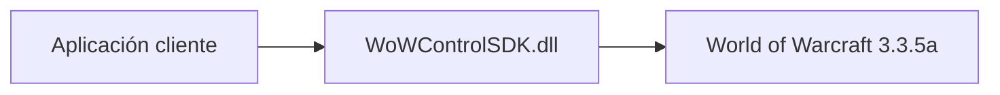

# Sitio de documentación

La documentación está escrita en Markdown, se compila con MkDocs Material y se publica en GitHub Pages. El inglés y el español se generan desde el mismo árbol de navegación.

## Componentes

| Componente | Versión | Función |
| --- | --- | --- |
| MkDocs | Se instala con MkDocs Material | Generador de sitio estático |
| MkDocs Material | 9.5.39 | Tema, navegación y búsqueda |
| mkdocs-static-i18n | 1.3.1 | Compilación en inglés y español desde la estructura de carpetas |
| Mermaid | Cargado por Material | Diagramas de flujo y de secuencia |
| GitHub Actions | `docs.yml` | Validación y despliegue |

Las versiones están fijadas en [`requirements-docs.txt`](https://github.com/Zerik-Official/WoWControlSDK/blob/main/requirements-docs.txt).

## Estructura

```text
docs/
├── README.md           # Índice del repositorio, excluido del sitio
├── en/                 # Sitio en inglés
│   ├── index.md
│   ├── getting-started.md
│   ├── architecture.md
│   ├── injection.md
│   ├── protocol.md
│   ├── glossary.md
│   ├── methods/
│   └── operations/
└── es/                 # Sitio en español, misma estructura
    ├── index.md
    ├── getting-started.md
    ├── architecture.md
    ├── injection.md
    ├── protocol.md
    ├── glossary.md
    ├── methods/
    └── operations/
```

El plugin i18n usa `docs_structure: folder`: la primera carpeta dentro de `docs/` selecciona el idioma. Cada página en inglés debe tener su equivalente en español con la misma ruta relativa, y al contrario.

`docs/README.md` está excluido con `exclude_docs` porque es un índice del repositorio, no una página del sitio.

## Servir en local

```bash
pip install -r requirements-docs.txt
mkdocs serve
```

| URL | Idioma |
| --- | --- |
| `http://127.0.0.1:8001/WoWControlSDK/docs/` | Inglés |
| `http://127.0.0.1:8001/WoWControlSDK/docs/es/` | Español |

MkDocs vigila los archivos y recompila el sitio cuando cambia una página o `mkdocs.yml`.

## Compilación

```bash
mkdocs build --strict
```

`--strict` convierte las advertencias en errores, así que los enlaces rotos o los archivos ilegibles hacen fallar la compilación. Las páginas que existen pero no están en `nav` solo se informan como mensaje informativo, y una traducción ausente no hace fallar la compilación por sí sola. El CI usa el mismo comando, así que una compilación estricta local es la comprobación más cercana al pipeline.

La salida se escribe en `site/`, que no está bajo control de versiones.

## Navegación

La sección `nav` de `mkdocs.yml` define el orden para ambos idiomas. Los títulos se escriben en inglés y se traducen con `nav_translations` para el español:

```yaml
nav:
  - Home: index.md
  - Getting started: getting-started.md
  - Architecture: architecture.md
  - Injection: injection.md
  - RPC protocol: protocol.md
  - Addon integration: addons.md
  - Methods:
      - methods/index.md
      - lua.*: methods/lua.md
      - unit.*: methods/unit.md
      - group.*: methods/group.md
      - player.*: methods/player.md
      - world.*: methods/world.md
      - friends.*: methods/friends.md
      - summon.*: methods/summon.md
      - lfg.*: methods/lfg.md
      - trade.*: methods/trade.md
      - duel.*: methods/duel.md
      - battlefield.*: methods/battlefield.md
      - chat.*: methods/chat.md
      - object.*: methods/object.md
      - client.*: methods/client.md
      - events.*: methods/events.md
      - dll.*: methods/dll.md
      - window.*: methods/window.md
  - Operations:
      - Building: operations/building.md
      - Desktop client: operations/cli.md
      - Releases: operations/releases.md
      - Documentation site: operations/documentation.md
  - Glossary: glossary.md
```

Después de añadir una página, regístrala en `nav` y añade el título en español a `nav_translations` si hace falta.

## Convenciones de escritura

- Usa mayúscula solo en la primera palabra de los títulos: `## Primeros pasos`, no `## Primeros Pasos`.
- Mantén ambos idiomas estructuralmente idénticos. Una tabla, sección o ejemplo en un idioma debe existir en el otro.
- Escribe con voz de guía: describe qué hace un componente y cómo usarlo. Evita narraciones en primera persona y la historia del proyecto.
- Usa tablas para parámetros, campos de respuesta, herramientas y decisiones.
- Usa `!!! note`, `!!! tip` y `!!! warning` para los avisos. La extensión `admonition` los renderiza en el sitio.
- Usa enlaces relativos dentro de la misma carpeta de idioma, por ejemplo `[Métodos](methods/index.md)` o `[Compilación](../operations/building.md)`. El plugin i18n los mantiene dentro del idioma actual.
- Usa Mermaid para flujos y relaciones. No dibujes diagramas con caracteres de caja.

### Ejemplo de Mermaid

````markdown

````

Mermaid requiere el bloque personalizado de `pymdownx.superfences` configurado en `mkdocs.yml`. Las gramáticas `flowchart` y `sequenceDiagram` cubren todos los diagramas de esta documentación.

## Integración continua

El flujo `CI` ejecuta `mkdocs build --strict` en cada pull request y push a `dev` y `main`.

El flujo `docs` se ejecuta en cada push a `main`. Instala las dependencias, ejecuta `mkdocs build --strict`, anida el sitio bajo `pages-root/docs/`, escribe un `index.html` raíz que redirige a `docs/`, sube el artefacto de Pages y deja que el trabajo `deploy` lo publique. El trabajo de despliegue también espera al trabajo `rebuild`, que compila la DLL y el inyector con la cadena de herramientas de 32 bits.

## GitHub Pages

El sitio se publica en <https://zerik-official.github.io/WoWControlSDK/docs/>. El repositorio debe usar GitHub Actions como origen de Pages:

1. Abre **Settings → Pages**.
2. Define **Source** como **GitHub Actions**.
3. Haz push a `main` o ejecuta el flujo `docs` manualmente desde la pestaña **Actions**.

La raíz del sitio de Pages redirige a `docs/`, así que ambas URL funcionan:

| URL | Contenido |
| --- | --- |
| `https://zerik-official.github.io/WoWControlSDK/` | Redirección a la documentación |
| `https://zerik-official.github.io/WoWControlSDK/docs/` | Documentación en inglés |
| `https://zerik-official.github.io/WoWControlSDK/docs/es/` | Documentación en español |

## Añadir una página

1. Crea la página en inglés dentro de `docs/en/` y la página en español en la misma ruta relativa dentro de `docs/es/`.
2. Añade la página a `nav` en `mkdocs.yml`.
3. Añade el título en español a `nav_translations` si la etiqueta de navegación se traduce.
4. Enlaza la página desde el índice o resumen correspondiente.
5. Ejecuta `mkdocs build --strict` y corrige cada advertencia.
6. Revisa ambas versiones de idioma en paralelo.
