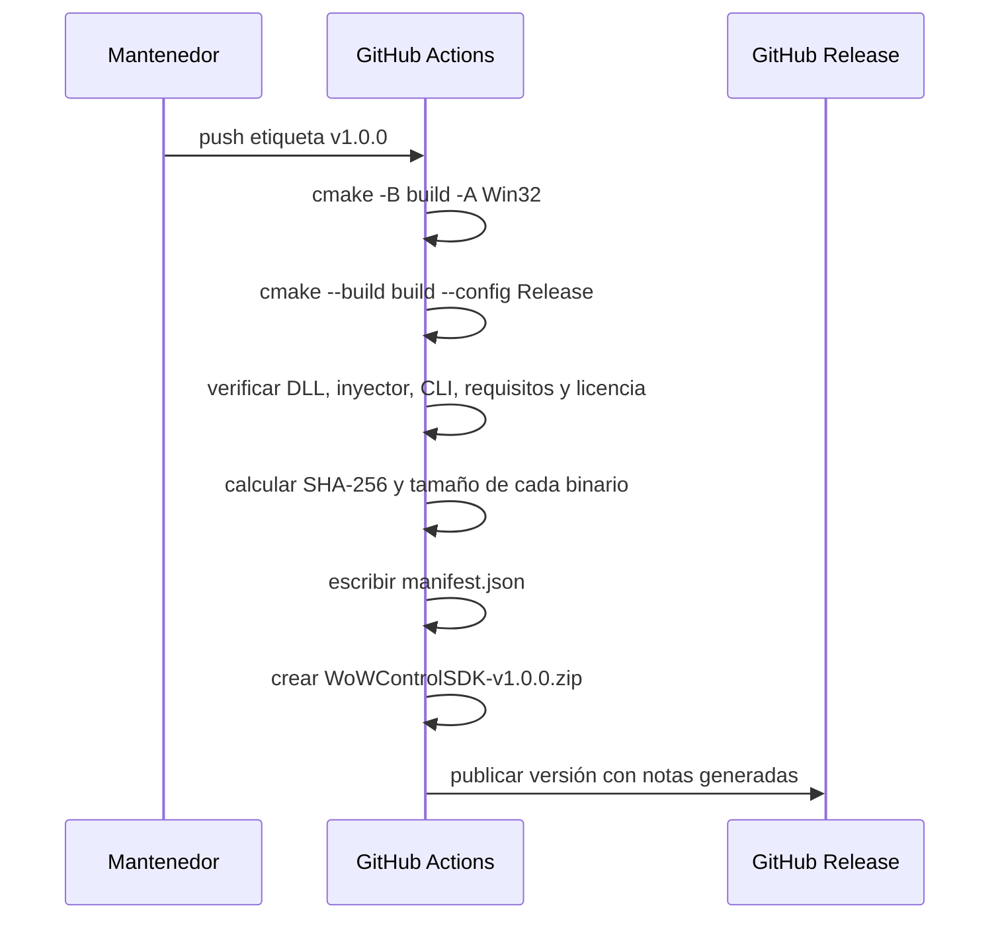

# Versiones

Una versión se crea empujando una etiqueta que empieza por `v`. El flujo `Build and Release` compila el SDK en un runner de Windows, verifica los artefactos, genera un manifiesto y publica una versión de GitHub.

## Disparador

```bash
git tag v1.0.0
git push origin v1.0.0
```

El nombre de la etiqueta se convierte en la versión y en el nombre del paquete.

## Pipeline



| Paso | Qué hace |
| --- | --- |
| Configurar | Ejecuta `cmake -B build -A Win32` |
| Compilar | Ejecuta `cmake --build build --config Release` |
| Verificar | Falla si falta `bin/release/WoWControlSDK.dll`, `bin/release/WowInjector.exe`, `tests/wowsdk_cli.py`, `requirements.txt` o `LICENSE` |
| Manifiesto | Calcula el hash SHA-256 y el tamaño en bytes de la DLL y del inyector |
| Empaquetar | Crea `release/WoWControlSDK-<version>/` y lo comprime en `WoWControlSDK-<version>.zip` |
| Publicar | Crea la versión de GitHub con notas generadas y sube el zip y `manifest.json` |

!!! note
    El paso de verificación espera `requirements.txt` en la raíz del repositorio. La versión falla si ese archivo no existe. Mantenlo sincronizado con las dependencias de Python del CLI.

## Contenido del paquete

```text
WoWControlSDK-<version>/
├── binaries/
│   ├── WoWControlSDK.dll
│   └── WowInjector.exe
├── wowsdk_cli.py
├── requirements.txt
├── LICENSE
└── manifest.json
```

## Manifiesto

El flujo escribe `manifest.json` con esta forma:

```json
{
  "schema_version": 1,
  "version": "v1.0.0",
  "commit": "<SHA completo del commit>",
  "artifacts": {
    "WoWControlSDK.dll": {
      "sha256": "<digest hexadecimal en minúsculas>",
      "size": 123456
    },
    "WowInjector.exe": {
      "sha256": "<digest hexadecimal en minúsculas>",
      "size": 654321
    }
  }
}
```

| Campo | Descripción |
| --- | --- |
| `schema_version` | Versión del formato del manifiesto. Actualmente `1` |
| `version` | Nombre de la etiqueta que disparó la versión |
| `commit` | SHA del commit al que apunta la etiqueta |
| `artifacts` | Mapa de nombre de archivo a hash y tamaño |

## Verificar una descarga

Compara el hash del binario descargado con el manifiesto:

```powershell
Get-FileHash .\WoWControlSDK.dll -Algorithm SHA256
```

El hash resultante debe coincidir con `artifacts["WoWControlSDK.dll"].sha256`.

## Paquete local

Una compilación local produce los mismos binarios, pero no el zip ni el manifiesto. Ejecuta los comandos de [Compilación](building.md) y recoge `bin/release/WoWControlSDK.dll` y `bin/release/WowInjector.exe` si necesitas un paquete sin GitHub Actions.

## Versionado

Las etiquetas no están vinculadas a una cadena de versión dentro de la DLL. El método `dll.getInfo` informa la versión compilada en el SDK, así que mantén ambas en sincronía cuando una versión cambie la superficie RPC pública.
